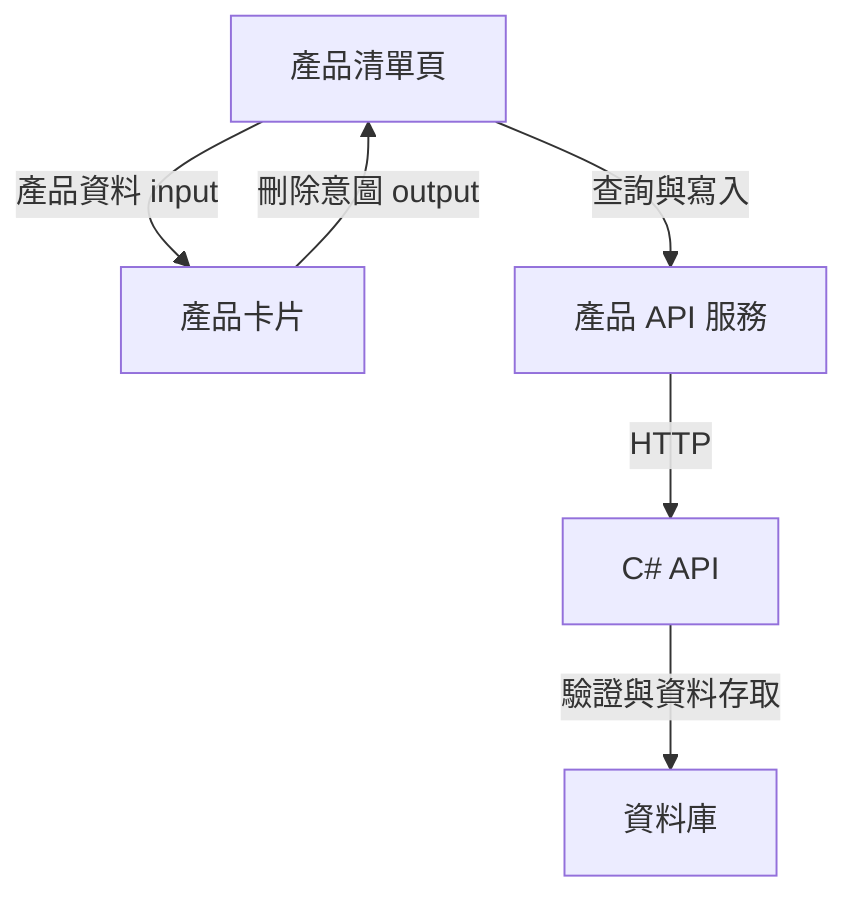

# 給 C# 工程師的 Angular 系統化學習教材（二）：元件、範本與狀態路由（第 5～8 章）

> 🏠 [回總目錄 (README)](./README.md) ｜ ⬅️ [上一篇：01_前端基礎與環境建立_Ch00-04](./01_前端基礎與環境建立_Ch00-04.md) ｜ ➡️ [下一篇：03_前後端API串接與表單實作_Ch09-13](./03_前後端API串接與表單實作_Ch09-13.md)

## 本篇目錄

- [5. 元件、範本與畫面繫結](#5-元件範本與畫面繫結)
- [6. Signals、computed 與 OnPush](#6-signalscomputed-與-onpush)
- [7. 元件溝通與相依性注入](#7-元件溝通與相依性注入)
- [8. 路由與應用程式骨架](#8-路由與應用程式骨架)

---

## 5. 元件、範本與畫面繫結

### 5.1 元件是有邊界的畫面單位

元件將畫面、行為與樣式放在可管理的邊界內。不要把 Angular 元件當成 C# Controller：Controller 處理一次 HTTP 請求；元件則可能存活一段時間，接收多次互動，持續維護畫面狀態。[O5]

概念範例：

```typescript
import { Component, signal } from '@angular/core';

@Component({
  selector: 'app-greeting',
  standalone: true,
  template: `
    <h2>{{ title() }}</h2>
    <button type="button" (click)="rename()">更換標題</button>
  `,
  styles: [`h2 { color: #174ea6; }`]
})
export class Greeting {
  readonly title = signal('產品管理');
  rename(): void { this.title.set('產品維護'); }
}
```

`selector` 是使用元件的標籤名稱；`template` 是範本；類別提供範本要讀取的狀態與方法。`standalone: true` 表示不必在 NgModule 宣告。Angular 19 起元件預設即為 `standalone: true`，可省略不寫；本教材主線實作檔案為求明確仍標示出來，而各章末的原文改寫範例則示範省略寫法。

### 5.2 四種常見繫結

| 語法 | 方向與用途 | 範例 |
|---|---|---|
| `{{ expression }}` | 狀態顯示為文字 | `{{ product.name }}` |
| `[property]="expression"` | 狀態設定到元素或元件屬性 | `[disabled]="saving()"` |
| `(event)="handler()"` | 事件回到 TypeScript | `(click)="save()"` |
| `[(ngModel)]` 等雙向繫結 | 同時讀寫，依指令 API 決定 | 需要 FormsModule；不要直接綁定唯讀 computed |

HTML 的 `disabled="false"` 仍然具有 disabled 屬性，按鈕仍可能被停用。要依布林值切換，使用 `[disabled]="false"`。`aria-*` 等 HTML 屬性常使用 `[attr.aria-label]`。

### 5.3 條件與清單

```html
@if (loading()) {
  <p role="status">載入中</p>
} @else if (message()) {
  <p role="alert">{{ message() }}</p>
} @else {
  <ul>
    @for (product of products(); track product.id) {
      <li>{{ product.name }}</li>
    } @empty {
      <li>沒有符合條件的產品</li>
    }
  </ul>
}
```

`track product.id` 提供穩定識別，讓 Angular 判斷哪筆資料沿用或重建。可排序、插入、刪除的清單，不要慣性使用陣列索引作為識別。`@if`、`@for` 是範本控制流程，不需要另外匯入 NgIf/NgFor。

### 5.4 Pipe 用於顯示轉換

```typescript
import { CurrencyPipe } from '@angular/common';
// @Component 的 imports 加入 CurrencyPipe
```

```html
<span>{{ product.priceInCents / 100 | currency:'TWD':'symbol':'1.2-2' }}</span>
```

Pipe 將值轉成適合顯示的格式，不應在格式化過程呼叫 API 或寫入資料。貨幣與日期格式涉及 locale，若需完整台灣格式，另行註冊 `zh-Hant` 等所需 locale 資料；不要將顯示字串當成金額資料存回 API。

### 5.5 生命週期

| 時機 | 常用位置 | 注意事項 |
|---|---|---|
| 取得相依服務、建立欄位 | 欄位初始化、constructor | 不要假設 DOM 或所有 input 已準備完成 |
| 初始 input 設定完成 | `ngOnInit()` | 適合依初始輸入執行工作 |
| input 變更 | Signal input 搭配 computed/resource，或 `ngOnChanges()` | 避免只讀一次快照後忽略後續變化 |
| 需要與實際渲染結果互動 | 適當的 render callback | 不要在任意生命週期修改 DOM |
| 元件銷毀 | DestroyRef、`ngOnDestroy()` | 清理計時器、外部事件及長期資源 |

完整生命週期見官方說明。[O6]

**練習與完成條件：**完成一個具有載入、錯誤、空資料和有資料四種狀態的靜態清單；使用穩定 ID 追蹤，並能解釋 property binding 與 attribute 的差異。

### 5.6 Razor 對照與舊語法提醒

> 💡 **C# 工程師這樣想**
>
> - `@Component` ≈ 一個同時描述 XAML 與 code-behind 的 Attribute。
> - `imports: [ProfilePhoto]` 相當於 XAML 的 `xmlns:local="clr-namespace:..."`：你必須明確宣告範本裡會用到哪些元件、指令或 Pipe，Angular 才認得那個標籤。這是現代 Angular 的「獨立元件（Standalone Component）」做法；舊版需要把元件宣告在 `NgModule` 裡，現在已經不必了（原文 2、3 都提到這點）。
> - Angular 22 的元件預設是 `standalone`，不用再寫 `standalone: true`。原文 2 的範例仍有這一行，是為了相容舊版，可以忽略。

> 💡 **C# 工程師這樣想**
>
> | Razor（Blazor / MVC） | Angular 範本 |
> |---|---|
> | `@Model.Name` / `@name` | `{{ name() }}` |
> | `@if (x) { } else { }` | `@if (x) { } @else { }` |
> | `@foreach (var b in badges) { }` | `@for (b of badges(); track b.id) { }` |
> | `disabled="@(!valid)"` | `[disabled]="!valid()"` |
> | `@onclick="Save"` | `(click)="save()"` |
>
> **舊語法提醒**：Angular 17 之前用的是 `*ngIf`、`*ngFor`（原文 7 會教你用一個指令自動遷移）。讀網路上的舊範例時看到 `*ngIf="x"`，請在腦中翻譯成 `@if (x) { }`。

---

## 6. Signals、computed 與 OnPush

### 6.1 狀態與衍生值分開

```typescript
import { computed, signal } from '@angular/core';

const price = signal(1200);
const quantity = signal(2);
const total = computed(() => price() * quantity());

quantity.set(3);
console.log(total()); // 3600
```

`signal` 存放可變狀態；`computed` 表示可由其他狀態推導出的值。讀取要加 `()`，更新用 `set()` 或 `update()`。computed 會追蹤執行時實際讀到的 Signal，並快取衍生結果。[O7]

C# 的一般屬性 getter 可以算出總額，但單靠 getter 不會讓瀏覽器知道畫面應重新更新。Signal 除了存值，也提供相依追蹤與更新通知。

### 6.2 清單狀態實作

```typescript
readonly products = signal<Product[]>([]);
readonly keyword = signal('');
readonly visibleProducts = computed(() => {
  const q = this.keyword().trim().toLocaleLowerCase();
  return this.products().filter(p => p.name.toLocaleLowerCase().includes(q));
});

increaseStock(id: number): void {
  this.products.update(items => items.map(p =>
    p.id === id ? { ...p, stock: p.stock + 1 } : p
  ));
}
```

以上片段放在有匯入 `Product`、`signal`、`computed` 的元件中。下面的寫法會直接修改陣列，無法可靠地形成 Signal 更新通知：

```typescript
this.products().push(newProduct);
// 改用：
this.products.update(items => [...items, newProduct]);
```

### 6.3 effect 的位置

`effect` 適合將反應式狀態同步到外部系統，例如第三方圖表。能用 computed 推導的值，直接用 computed；不要用多個 effect 互相拷貝欄位，形成難以追蹤的更新鏈。

effect 通常在注入情境內建立。不要把它理解為「數值改了立刻同步執行的 C# 事件」，也不要把必須可靠執行的伺服器寫入操作，藏在 effect 裡。

### 6.4 OnPush 與 zoneless 是兩件事

- **OnPush**：決定元件在何種條件下需要檢查。
- **Zoneless**：Angular 不依賴 Zone.js 攔截非同步活動來排程更新。

Angular 官方文件指出，OnPush 自 v22 起為預設，zoneless 則自 v21 起為預設。它們互相關聯，但不能當成同一個開關。[O8]、[O9]

範本讀到的 Signal 更新會提供通知；範本事件、AsyncPipe 及明確的 `markForCheck()` 也是相關機制。因此，不是「只要欄位改了就一定更新」，也不是「只有 input 改了才會更新」。

第 3 章的計時器範例同時使用 Signal 與 DestroyRef，是較完整的學習版本。只有 `setInterval(() => this.count++, 1000)` 的一般欄位更新，無法保證在 OnPush/zoneless 下更新畫面，且會缺少清理。

### 6.5 升級舊元件時逐一檢查

既有專案升級後，移轉工具可能保留 Eager 策略維持行為。先找出非同步回呼、物件原地修改、外部套件更新與手動訂閱，再逐一測試。能建置成功不代表畫面更新路徑已正確。

**練習與完成條件：**完成可搜尋的產品清單，總庫存用 computed 推導；替換陣列時畫面立即反映結果；離開計時器元件後，確認計時器已停止。

### 6.6 官方 Signals 範例與 .NET 類比

這是理解 Angular 22 最重要的概念。官方定義：**Signal 是一個包著值的容器**，Angular 會追蹤「誰讀過它」，當值改變時自動更新相關畫面。這個能力叫「響應性（reactivity）」。

#### `signal()`：建立與更新

```typescript
import { signal } from '@angular/core';

// 建立 signal
const firstName = signal('Morgan');

// 讀取：像呼叫函式一樣加 ()
console.log(firstName());

// 改值：set
firstName.set('Jaime');

// 依舊值計算新值：update
firstName.update((name) => name.toUpperCase());
```

#### `computed()`：衍生值（唯讀）

```typescript
import { signal, computed } from '@angular/core';

const firstName = signal('Morgan');
const firstNameCapitalized = computed(() => firstName().toUpperCase());
console.log(firstNameCapitalized()); // MORGAN

firstName.set('Jaime');
console.log(firstNameCapitalized()); // JAIME
```

`computed` 沒有 `set` / `update`，它只會在所依賴的 signal 改變時重新計算。

#### 在元件中使用

```typescript
@Component({ /* ... */ })
export class UserProfile {
  isTrial = signal(false);
  isTrialExpired = signal(false);
  showTrialDuration = computed(() => this.isTrial() && !this.isTrialExpired());

  activateTrial() {
    this.isTrial.set(true);
  }
}
```

#### `effect()`：副作用

依官方 Signals 指南，`effect` 會在它讀過的 signal 改變時重新執行：

```typescript
effect(() => {
  console.log(`User set to ${currentUser()} and the counter is ${counter()}`);
});
```

若某個 signal 只想「讀」而不想被追蹤，用 `untracked`：

```typescript
effect(() => {
  console.log(`User set to ${currentUser()} and the counter is ${untracked(counter)}`);
});
```

官方的使用原則：**要「回應狀態變化」請用 `computed`（或 resource，見第 19.8 節）；`effect` 只用在必須呼叫非響應式 API 的副作用**（例如寫 log、操作第三方函式庫）。另外，響應式追蹤只涵蓋同步程式碼，`await` 之後讀到的 signal 不會被追蹤，所以要先讀再 `await`。

> 💡 **C# 工程師這樣想**
>
> | .NET | Angular Signal |
> |---|---|
> | `INotifyPropertyChanged` + 屬性 setter 裡呼叫 `OnPropertyChanged()` | `signal()`，`set()` 時自動通知 |
> | 一個依賴其他屬性的唯讀計算屬性（但你要自己記得在來源改變時發通知） | `computed()`，**自動**追蹤依賴 |
> | `PropertyChanged += handler` | `effect()` |
> | ReactiveUI 的 `ReactiveProperty` / `WhenAnyValue` | 最接近的類比 |
>
> 關鍵差別：C# 的 `INotifyPropertyChanged` 要手動維護「誰依賴誰」；Signal 則在你**讀取**時自動建立依賴圖。這就是為什麼第 19.8 節說「OnPush + signals」能讓 Angular 精準知道該更新哪個元件。
>
> 語法上要適應的一點：**讀 signal 要加 `()`**。`count` 是容器，`count()` 才是值。範本裡也一樣：`{{ count() }}`。

### 6.7 變更偵測的 .NET 類比

Angular 怎麼知道「該重新渲染畫面了」？歷史上有兩種方式：

**（舊）Zone.js + Default 策略**：Zone.js 會攔截瀏覽器所有非同步事件（點擊、計時器、HTTP 回應……），每次事件結束後，Angular **檢查整棵元件樹**的每個繫結有沒有變。很寬容（怎麼寫都會更新），但很慢，也難以預測。

**（新）OnPush + Signals（無 Zone.js）**：元件只在「輸入改變」、「範本中的事件觸發」或「所讀的 signal 改變」時才檢查。Angular 精準知道該更新哪個元件。

```typescript
@Component({
  selector: 'app-counter',
  changeDetection: ChangeDetectionStrategy.OnPush,   // 22 之前要手動寫；22 起是預設
  template: `<p>{{ count() }}</p>`,
})
export class Counter {
  count = signal(0);
}
```

> 💡 **C# 工程師這樣想**
>
> - Default 策略像 WinForms 每次事件後呼叫 `this.Refresh()` 重畫整個視窗。
> - OnPush + Signal 像 WPF 的 Binding：只有發出 `PropertyChanged` 的那個屬性會更新。
> - 如果你在 OnPush 元件裡用**普通欄位**（`count = 0; count++`）改狀態，畫面**不會更新**，因為沒人通知 Angular。這正是原文 6 開頭那位同事「計數器停在零」的故事，也是 Angular 22 最重要的習慣改變。

> 📌 **校正（依本教材第 6.4 節）**：**OnPush 與 zoneless 是兩件事**，不能當成同一個開關。OnPush 決定「元件在何種條件下需要檢查」；zoneless 則是「Angular 不再依賴 Zone.js 攔截非同步活動來排程更新」。官方文件指出 zoneless 自 v21 起為預設，OnPush 自 v22 起為預設。另外，「OnPush 只看 input」也不正確：範本讀到的 Signal 更新、範本事件、`AsyncPipe` 以及明確的 `markForCheck()` 都會影響檢查排程。所以既不是「欄位改了就一定更新」，也不是「只有 input 改了才會更新」。

---

## 7. 元件溝通與相依性注入

### 7.1 分清楚頁面與可重用介面

產品清單頁面負責查詢、刪除與導覽；產品卡片只負責呈現單筆資料並發出操作意圖。不要讓每張卡片都自行查同一份產品清單。



### 7.2 input 往下、output 往上

概念範例，可放在獨立練習元件：

```typescript
import { Component, input, output } from '@angular/core';
import type { Product } from './product';

@Component({
  selector: 'app-product-card',
  standalone: true,
  template: `
    <article>
      <h2>{{ product().name }}</h2>
      <p>庫存：{{ product().stock }}</p>
      <button type="button" (click)="removeRequested.emit(product().id)">
        刪除
      </button>
    </article>
  `
})
export class ProductCard {
  readonly product = input.required<Product>();
  readonly removeRequested = output<number>();
}
```

父元件將 ProductCard 放進 `imports` 後使用：

```html
<app-product-card [product]="product" (removeRequested)="remove($event)" />
```

這裡的 `product` 是父範本迴圈中的單筆產品，`remove()` 由父元件提供。子元件不直接改父元件的產品物件，而是發出事件，讓擁有資料的一方決定如何處理。

### 7.3 Service 是職責分離

C# 工程師熟悉 DI，可以沿用「明確相依、可替換、方便測試」的觀念。Angular 服務可封裝 API、共用狀態及可重用行為；不應把整個系統的所有邏輯塞進一個 `CommonService`。

```typescript
import { Injectable, inject } from '@angular/core';
import { HttpClient } from '@angular/common/http';

@Injectable({ providedIn: 'root' })
export class ProductApi {
  private readonly http = inject(HttpClient);
}
```

`providedIn: 'root'` 讓服務可由根注入器取得，一般同一個應用程式內會共用。若在元件等較下層重新提供服務，可能建立不同實例，因此不要將它視為跨分頁、跨使用者或整個伺服器的全域 Singleton。

Angular 22 也提供 `@Service()` 簡寫。主線先保留常見的 `@Injectable`，方便銜接既有程式；第 19 章說明新版寫法。`@Injectable` 仍可使用。[O10]

### 7.4 interface 不是注入 token

TypeScript interface 在執行時不存在。不能直接 `inject(IProductApi)`，必須使用有執行時身分的類別，或以 `InjectionToken<T>` 提供抽象契約。第 9 章會用 token 傳入公開設定。

### 7.5 狀態放哪裡

| 狀態的使用範圍 | 起始放置位置 |
|---|---|
| 一個元件的展開／收合 | 元件 Signal |
| 同一個功能的多個頁面 | 功能服務，確認其提供範圍 |
| 可分享的搜尋、分頁 | URL query parameters，並同步畫面狀態 |
| API 事實資料 | 伺服器為準，前端管理查詢結果與失效更新 |
| 多功能共享且流程複雜 | 再評估正式狀態管理方案 |

Signals 不會自動解決「誰擁有資料」「寫入後誰刷新」等問題。先定義資料所有權，再選工具。

**練習與完成條件：**拆分產品卡片，父元件接到 output 才執行刪除；說明元件 `imports` 與服務 `providers` 的不同；解釋重新提供服務為何可能產生另一份狀態。

### 7.6 `input()` / `output()` 的官方範例與 .NET 對照

```typescript
import { Component, input } from '@angular/core';

@Component({ /* ... */ })
export class CustomSlider {
  value = input(0);                     // 有預設值 → InputSignal<number>
}
```

必填輸入：

```typescript
export class CustomSlider {
  value = input.required<number>();     // 沒給就是建置錯誤
}
```

讀取輸入（它是唯讀的 signal）：

```typescript
export class CustomSlider {
  value = input(0);
  label = computed(() => `The slider's value is ${this.value()}`);
}
```

父元件範本中繫結：

```html
<custom-slider [value]="50" />
```

官方說明：舊的裝飾器寫法 `@Input() value = 0;` 仍完全支援，但新專案建議用 `input()`。原文 2 的範例使用 `@Input()`，原文 7 則教你用指令自動轉成 `input()`。

#### 輸出（Output）：子元件通知父元件

```typescript
import { Component, output } from '@angular/core';

@Component({ /* ... */ })
export class ExpandablePanel {
  panelClosed = output<void>();

  close() {
    this.panelClosed.emit();
  }
}
```

父元件監聽：

```html
<expandable-panel (panelClosed)="savePanelState()" />
```

帶資料：

```typescript
this.valueChanged.emit(7);
```

```html
<custom-slider (valueChanged)="logValue($event)" />
```

舊寫法是 `@Output() saved = new EventEmitter<void>();`（原文 2 使用）。

> 💡 **C# 工程師這樣想**
>
> - `input()` ≈ WPF 的 `DependencyProperty`，或 Blazor 的 `[Parameter]`。
> - `output()` ≈ C# 的 `event`；`.emit()` ≈ `Invoke()`；父範本的 `(panelClosed)="..."` ≈ `+=` 訂閱。
> - 資料流是單向的：**資料往下（input），事件往上（output）**。

### 7.7 相依性注入的官方範例與 ASP.NET Core 對照

依官方 Essentials，服務（Service）就是一個可被注入的可重用類別：

```typescript
import { Service } from '@angular/core';

@Service()
export class Calculator {
  add(x: number, y: number) {
    return x + y;
  }
}
```

使用方式：`import` 它，然後宣告一個欄位並用 `inject()` 取得實例。

```typescript
import { Component, inject } from '@angular/core';
import { Calculator } from './calculator';

@Component({
  selector: 'app-receipt',
  template: `<h1>The total is {{ totalCost }}</h1>`,
})
export class Receipt {
  private calculator = inject(Calculator);
  totalCost = this.calculator.add(50, 25);
}
```

**三種你會在文章中看到的寫法（由舊到新）：**

```typescript
// (1) 最舊：建構函式注入 + @Injectable
@Injectable({ providedIn: 'root' })
export class CartService { }

export class Checkout {
  constructor(private cart: CartService) {}
}

// (2) Angular 14+：inject() 函式
export class Checkout {
  private cart = inject(CartService);
}

// (3) Angular 22：@Service() 取代 @Injectable({ providedIn: 'root' })
@Service()
export class CartService { }
```

三者功能相同。原文 6 第 5 節與原文 7 第 4 節分別說明 `@Service()` 與 `inject()` 的遷移。

> 💡 **C# 工程師這樣想**
>
> | ASP.NET Core | Angular |
> |---|---|
> | `builder.Services.AddSingleton<CartService>()` | `@Service()`（或 `@Injectable({ providedIn: 'root' })`）：應用程式層級的單例 |
> | 建構函式注入 `public Checkout(CartService cart)` | 舊寫法相同；新寫法改用欄位初始化 `inject()` |
> | `IServiceProvider` | `Injector` |
> | 在 `Program.cs` 註冊 | 在 `app.config.ts` 的 `providers` 註冊（框架級服務如 `provideRouter()`、`provideHttpClient()`） |
>
> 預設的 Angular 服務是 **singleton**，沒有 ASP.NET Core 的 scoped / transient 概念（可以透過在元件的 `providers` 註冊做出類似元件層級的範圍，但入門先不用管）。

---

## 8. 路由與應用程式骨架

### 8.1 畫面 URL 不等於 API URL

`/products/1/edit` 表示使用者正在編輯產品的畫面；`/api/products/1` 表示 API 資源。使用者重新整理畫面時，網頁伺服器要能回傳 Angular 的入口頁面；這與 C# API 的路由處理分開設定。

以下開始建立主線程式。尚未建立的產品頁面會在第 10、11 章補齊，全部完成後再建置。[O11]

### 8.2 路由定義

實作檔案：`src/app/app.routes.ts`。

<!-- file: src/app/app.routes.ts -->
```typescript
import type { Routes } from '@angular/router';

export const routes: Routes = [
  { path: '', pathMatch: 'full', redirectTo: 'products' },
  {
    path: 'products',
    loadComponent: () => import('./features/products/product-list')
      .then(m => m.ProductList)
  },
  {
    path: 'products/new',
    loadComponent: () => import('./features/products/product-edit')
      .then(m => m.ProductEdit)
  },
  {
    path: 'products/:id/edit',
    loadComponent: () => import('./features/products/product-edit')
      .then(m => m.ProductEdit)
  },
  { path: '**', redirectTo: 'products' }
];
```

`loadComponent` 使用動態 import，讓頁面有機會成為獨立 chunk。參數路由要留意與固定路徑的匹配順序；萬用路由放最後。正式系統通常另建清楚的找不到頁面，這裡採導回清單以縮小練習範圍。

### 8.3 根元件

實作檔案：`src/app/app.ts`。將 CLI 原本的根元件內容替換如下；範本採 inline，因此原本的 `app.html` 不再被使用。

<!-- file: src/app/app.ts -->
```typescript
import { Component } from '@angular/core';
import { RouterLink, RouterOutlet } from '@angular/router';

@Component({
  selector: 'app-root',
  standalone: true,
  imports: [RouterLink, RouterOutlet],
  template: `
    <header><a routerLink="/products">產品管理後台</a></header>
    <main><router-outlet /></main>
  `
})
export class App {}
```

`router-outlet` 是目前頁面出現的位置。`routerLink` 讓 Angular 處理站內導覽，通常不需整頁重新載入。

### 8.4 為何不只讀 snapshot

Angular 可能重用同一個元件來呈現不同路由參數。`route.snapshot.paramMap.get('id')` 只讀當下快照，不會自動跟隨後續變化。主線編輯頁會訂閱 `paramMap` 並使用 `switchMap`，確保 `/products/1/edit` 切到 `/products/2/edit` 時讀取正確資料。

### 8.5 Guard 不等於授權

Guard 可以在未登入時導向登入頁，或避免使用者誤進不適用的畫面，但使用者可以直接發出 HTTP 請求。所有資料授權與租戶隔離必須在 API 驗證。主線練習尚未實作登入，不能直接作為公開管理系統上線。

**練習與完成條件：**完成根元件與路由檔，理解 redirect、動態 import、路由參數、萬用路由；待後續頁面完成後，觀察 Network 中的頁面 chunk 載入。

### 8.6 SPA 原理與 ASP.NET 路由對照

官方路由文件對 SPA 的描述：瀏覽器只向伺服器要**一次** `index.html`，之後所有「換頁」都是由瀏覽器端的 Router 根據 URL 切換要顯示的元件，**不會重新載入整頁**。

> 💡 **C# 工程師這樣想**
>
> ASP.NET MVC 每個 URL 都會打到伺服器、由 Controller 回傳整頁 HTML；Angular 則是伺服器只負責丟出一份靜態檔案，之後「頁面切換」全部在瀏覽器完成。這也是第 18 章 Docker 部署時，Nginx 需要 `try_files ... /index.html` 的原因：使用者直接開 `/dashboard`，伺服器上根本沒有這個檔案，必須回 `index.html` 讓 Angular 自己處理。

> 💡 **C# 工程師這樣想**
>
> - `Routes` 陣列 ≈ ASP.NET 的 `MapControllerRoute`，但比對發生在瀏覽器。
> - `<router-outlet />` ≈ MVC Layout 的 `@RenderBody()`。
> - `routerLink` ≈ `asp-action` tag helper，差別是不會重新向伺服器要整頁。
> - `path: 'user/:id'` ≈ `[Route("user/{id}")]`。
> - 延遲載入沒有直接對應，可想成「這個 Controller 的 DLL 等到有人用才下載」。

---

> 🏠 [回總目錄 (README)](./README.md) ｜ ⬅️ [上一篇：01_前端基礎與環境建立_Ch00-04](./01_前端基礎與環境建立_Ch00-04.md) ｜ ➡️ [下一篇：03_前後端API串接與表單實作_Ch09-13](./03_前後端API串接與表單實作_Ch09-13.md)
---

<!-- 官方參考資料連結定義（供本篇內文 [O1]～[O36] 參照） -->
[O1]: https://angular.dev/reference/releases
[O2]: https://angular.dev/reference/versions
[O3]: https://www.typescriptlang.org/docs/handbook/typescript-in-5-minutes-oop.html
[O4]: https://angular.dev/guide/http/making-requests
[O5]: https://angular.dev/essentials/components
[O6]: https://angular.dev/guide/components/lifecycle
[O7]: https://angular.dev/guide/signals
[O8]: https://angular.dev/guide/components/advanced-configuration
[O9]: https://angular.dev/guide/zoneless
[O10]: https://angular.dev/api/core/Service
[O11]: https://angular.dev/guide/routing/define-routes
[O12]: https://learn.microsoft.com/en-us/aspnet/core/fundamentals/minimal-apis?view=aspnetcore-10.0
[O13]: https://angular.dev/guide/http/http-resource
[O14]: https://angular.dev/guide/signals/resource
[O15]: https://angular.dev/guide/forms/reactive-forms
[O16]: https://angular.dev/guide/forms/signals/comparison
[O17]: https://angular.dev/guide/forms/signals/form-submission
[O18]: https://angular.dev/guide/http/testing
[O19]: https://angular.dev/best-practices/security
[O20]: https://angular.dev/guide/templates/defer
[O21]: https://angular.dev/guide/di/lazy-loading-services
[O22]: https://angular.dev/tools/libraries/creating-libraries
[O23]: https://angular.dev/tools/libraries/angular-package-format
[O24]: https://angular.dev/guide/elements
[O25]: https://angular.dev/api/platform-browser/createApplication
[O26]: https://docs.docker.com/build/building/multi-stage/
[O27]: https://nginx.org/en/docs/http/ngx_http_core_module.html#try_files
[O28]: https://angular.dev/reference/migrations
[O29]: https://angular.dev/ai/mcp
[O30]: https://angular.dev/update-guide
[O31]: https://angular.dev/guide/templates/expression-syntax
[O32]: https://angular.dev/api/router/RouterConfigOptions
[O33]: https://angular.dev/api/common/http/withXhr
[O34]: https://angular.dev/api/platform-browser/provideClientHydration
[O35]: https://angular.dev/guide/ssr
[O36]: https://angular.dev/essentials/signal-forms
