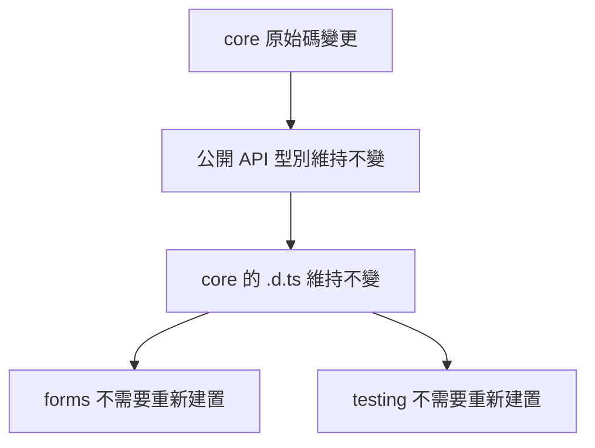
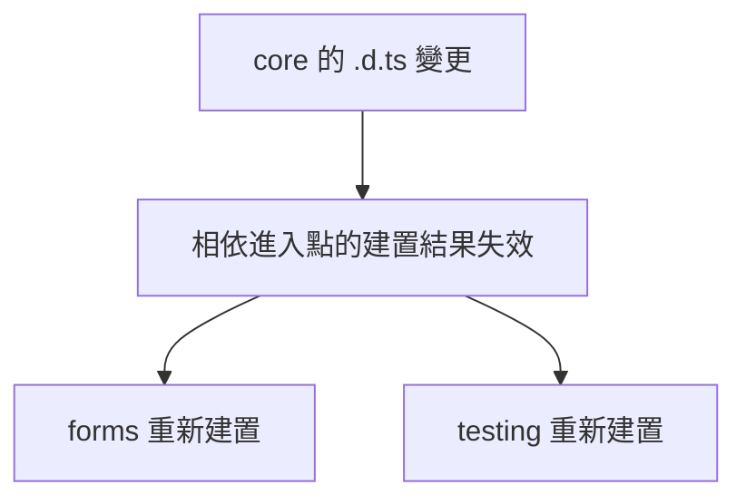

# 給 C# 工程師的 Angular 系統化學習教材（四）：測試除錯、效能與共用元件架構（第 14～17 章）

> 🏠 [回總目錄 (README)](./README.md) ｜ ⬅️ [上一篇：03_前後端API串接與表單實作_Ch09-13](./03_前後端API串接與表單實作_Ch09-13.md) ｜ ➡️ [下一篇：05_容器部署升級與未來趨勢_Ch18-20](./05_容器部署升級與未來趨勢_Ch18-20.md)

## 本篇目錄

- [14. 除錯、測試、安全與無障礙](#14-除錯測試安全與無障礙)
- [15. 效能、延遲載入與渲染](#15-效能延遲載入與渲染)
- [16. 共用 Angular 函式庫與建置器](#16-共用-angular-函式庫與建置器)
- [17. Web Components 與 Angular Elements](#17-web-components-與-angular-elements)

---

## 14. 除錯、測試、安全與無障礙

### 14.1 依證據排查

| 現象 | 優先檢查 | 常見原因 |
|---|---|---|
| 完全沒有畫面 | Console、設定檔請求 | 啟動例外、設定不存在 |
| 元件標籤無法辨識 | 元件 imports | 只有 TypeScript import，未供範本使用 |
| 點儲存沒有請求 | 表單驗證、事件 | invalid、提交未接上、按鈕類型錯誤 |
| 請求回 200 卻顯示解析錯誤 | Response 與 Content-Type | API 路徑被 SPA fallback 回成 HTML |
| 編輯不同 ID 仍顯示舊資料 | 路由參數與訂閱 | 只讀 snapshot、舊請求覆蓋 |
| 資料已改但畫面不動 | 更新方式與通知 | 原地修改物件、一般欄位非同步更新 |
| 本機正常，容器異常 | API URL 與代理 | 容器的 localhost 被誤認為 API 主機 |
| 重整子頁變 404 | 網頁伺服器 | 缺少 SPA 路由 fallback |

先確認請求送去哪個 URL，再確認回應。不要把清快取、重新安裝相依套件當成所有問題的預設處理。

### 14.2 驗證有意義的行為

主線使用 CLI 建立的測試目標。以下測試不連真實 API，而是驗證欄位邊界、HTTP 契約及錯誤映射。HTTP 測試中先提供 HttpClient，再以 testing provider 替換後端。[O18]

實作檔案：`src/app/features/products/product-validators.spec.ts`。

<!-- file: src/app/features/products/product-validators.spec.ts -->
```typescript
import { describe, expect, it } from 'vitest';
import { FormControl } from '@angular/forms';
import { trimmedNameValidator, wholeNumberValidator } from './product-validators';

describe('產品輸入邊界', () => {
  it('拒絕只有空白的名稱', () => {
    expect(trimmedNameValidator(new FormControl('   '))).toEqual({ trimmedName: true });
  });
  it('以去除前後空白後的長度檢查名稱', () => {
    expect(trimmedNameValidator(new FormControl('  鍵盤  '))).toBeNull();
    expect(trimmedNameValidator(new FormControl('a'.repeat(81)))).not.toBeNull();
  });
  it('允許零，拒絕小數與空值', () => {
    expect(wholeNumberValidator(new FormControl(0))).toBeNull();
    expect(wholeNumberValidator(new FormControl(1.5))).not.toBeNull();
    expect(wholeNumberValidator(new FormControl(null))).not.toBeNull();
  });
  it('拒絕超出安全整數範圍的數值', () => {
    expect(wholeNumberValidator(new FormControl(Number.MAX_SAFE_INTEGER + 1))).not.toBeNull();
  });
});
```

實作檔案：`src/app/features/products/product-api.spec.ts`。

<!-- file: src/app/features/products/product-api.spec.ts -->
```typescript
import { afterEach, beforeEach, describe, expect, it } from 'vitest';
import { TestBed } from '@angular/core/testing';
import { provideHttpClient } from '@angular/common/http';
import { HttpTestingController, provideHttpClientTesting } from '@angular/common/http/testing';
import { firstValueFrom } from 'rxjs';
import { PUBLIC_CONFIG } from '../../core/public-config';
import { ProductApi, apiErrorMessage } from './product-api';

describe('ProductApi 契約', () => {
  let api: ProductApi;
  let http: HttpTestingController;

  beforeEach(() => {
    TestBed.configureTestingModule({ providers: [
      provideHttpClient(), provideHttpClientTesting(),
      { provide: PUBLIC_CONFIG, useValue: { apiBaseUrl: '/api', environmentName: 'test' } }
    ] });
    api = TestBed.inject(ProductApi);
    http = TestBed.inject(HttpTestingController);
  });
  afterEach(() => http.verify());

  it('新增送出約定欄位並接收伺服器產生的 id', async () => {
    const value = { name: '鍵盤', priceInCents: 120000, stock: 3, isActive: true };
    const pending = firstValueFrom(api.create(value));
    const request = http.expectOne('/api/products');
    expect(request.request.method).toBe('POST');
    expect(request.request.body).toEqual(value);
    request.flush({ id: 9, ...value }, { status: 201, statusText: 'Created' });
    expect((await pending).id).toBe(9);
  });

  it('更新不存在的產品時保留 404 語意', async () => {
    const pending = firstValueFrom(api.update(999, {
      name: '不存在', priceInCents: 0, stock: 0, isActive: false
    })).catch(error => apiErrorMessage(error));
    const request = http.expectOne('/api/products/999');
    expect(request.request.method).toBe('PUT');
    request.flush(null, { status: 404, statusText: 'Not Found' });
    expect(await pending).toBe('資料已不存在，請重新查詢。');
  });

  it('刪除接受沒有 JSON 本文的 204 回應', async () => {
    const pending = firstValueFrom(api.remove(9));
    const request = http.expectOne('/api/products/9');
    expect(request.request.method).toBe('DELETE');
    request.flush(null, { status: 204, statusText: 'No Content' });
    await pending;
  });
});
```

替換 CLI 原先配合歡迎頁面的根元件測試。實作檔案：`src/app/app.spec.ts`。

<!-- file: src/app/app.spec.ts -->
```typescript
import { describe, expect, it } from 'vitest';
import { TestBed } from '@angular/core/testing';
import { provideRouter } from '@angular/router';
import { App } from './app';

describe('後台導覽入口', () => {
  it('提供返回產品清單的連結', async () => {
    await TestBed.configureTestingModule({
      imports: [App], providers: [provideRouter([])]
    }).compileComponents();
    const fixture = TestBed.createComponent(App);
    fixture.detectChanges();
    const link = fixture.nativeElement.querySelector('header a') as HTMLAnchorElement;
    expect(link.textContent).toContain('產品管理後台');
    expect(link.getAttribute('href')).toBe('/products');
  });
});
```

```bash
npx ng test --watch=false
```

這八個測試不取代實際瀏覽器操作驗收。另需測試錯誤回應的畫面、鍵盤流程、快速路由切換，以及部署後的重新整理。正式專案可用端對端工具覆蓋關鍵使用者流程。

### 14.3 安全的責任邊界

前端繫結文字可降低直接插入 HTML 的風險，但不等於整個系統已免於 XSS。不要為了消除錯誤而隨意呼叫 `bypassSecurityTrustHtml`。確實需要 HTML 時，先建立可信任來源與消毒處理策略。[O19]

本教材沒有完整登入流程。正式系統應在 API 驗證身分、角色、租戶與每筆資料的可存取範圍。使用者自己傳入 tenantId，不代表已取得該租戶權限。

跨來源 API 需要正確配置 CORS；CORS 是瀏覽器讀取跨來源回應的限制機制，不是 API 的身分驗證。採 Cookie 驗證時，要另外處理 CSRF 與 Cookie 設定；採 Token 時，要依系統架構決定儲存和更新方式，不能把長效私密憑證寫進前端設定。

### 14.4 無障礙是操作能力

讓每個輸入有可辨識的標籤、錯誤可理解、焦點可見；不要只用紅色表示錯誤。清單載入使用 status，失敗使用 alert。對話框需處理進入、關閉及焦點返回。自訂按鈕優先用原生 button，不要讓 div 模擬按鈕卻忘記鍵盤行為。

**練習與完成條件：**測試通過；只靠鍵盤完成新增；API 失敗時保留輸入；能說明前端 Guard、CORS、後端授權及 XSS 防護分別處理哪個問題。

---

## 15. 效能、延遲載入與渲染

### 15.1 先量測，再選工具

將效能分成首次載入、互動反應、資料請求與建置成本。各自使用 Network、Performance、Angular DevTools、API 記錄與 CI 記錄觀察。來源文章的體積或時間數字是特定情境，不能直接當作自己專案的預期改善幅度。

```bash
npx ng build --configuration production --stats-json
```

在輸出目錄尋找 stats.json，再用相容的 esbuild 分析方式檢視模組分布。先找出大型相依與重複載入，再決定是否延後載入。

### 15.2 三種延遲載入

| 方法 | 分割邊界 | 例子 |
|---|---|---|
| 路由 `loadComponent` | 頁面 | 進入報表頁才下載頁面 |
| `@defer` | 頁面中的一塊介面 | 圖表進入可視區域才載入 |
| `injectAsync` | 服務及其相依程式碼 | 點匯出才載入匯出服務 |

`@defer` 概念範例：

```html
@defer (on viewport) {
  <app-sales-chart />
} @placeholder {
  <p>圖表尚未載入</p>
} @loading {
  <p role="status">圖表載入中</p>
} @error {
  <p role="alert">圖表載入失敗</p>
}
```

`app-sales-chart` 需要實際存在，且符合延後載入相依的條件。直接相依通常需為 standalone，並避免在同檔案其他地方提前引用它；只有包上 defer 區塊，不保證整個相依套件都獨立出去。[O20]

### 15.3 injectAsync 的完整命名匯出寫法

以下是獨立延伸範例，不是產品主線必備檔案。

```typescript
// report-exporter.ts
import { Injectable } from '@angular/core';

@Injectable({ providedIn: 'root' })
export class ReportExporter {
  download(rows: unknown[]): void {
    const blob = new Blob([JSON.stringify(rows, null, 2)], {
      type: 'application/json;charset=utf-8'
    });
    const url = URL.createObjectURL(blob);
    const anchor = document.createElement('a');
    anchor.href = url;
    anchor.download = 'products.json';
    anchor.click();
    setTimeout(() => URL.revokeObjectURL(url), 1000);
  }
}
```

```typescript
// export-button.ts
import { Component, injectAsync, input, signal } from '@angular/core';

@Component({
  selector: 'app-export-button',
  standalone: true,
  template: `
    <button type="button" [disabled]="busy()" (click)="download()">匯出 JSON</button>
    @if (error()) { <p role="alert">{{ error() }}</p> }
  `
})
export class ExportButton {
  readonly rows = input<unknown[]>([]);
  readonly busy = signal(false);
  readonly error = signal('');
  private readonly exporter = injectAsync(() => import('./report-exporter')
    .then(m => m.ReportExporter));

  async download(): Promise<void> {
    if (this.busy()) return;
    this.busy.set(true);
    this.error.set('');
    try { (await this.exporter()).download(this.rows()); }
    catch { this.error.set('匯出功能載入或執行失敗。'); }
    finally { this.busy.set(false); }
  }
}
```

命名匯出的服務使用 `.then(m => m.ReportExporter)` 明確選出類別；直接回傳 `import('./report-exporter')` 的簡寫，應對應到服務為 default export 的情況。服務必須可自動提供；也要避免其他程式以靜態 import 提前載入相同大型相依。[O21]

JSON 範例用於觀察 chunk 邊界。沒有大型相依時，效益可能很小；不要只為減少初始數字而將每個小函式都拆成網路請求。

### 15.4 CSR、SSR、SSG 與 hydration

| 名詞 | 意義 | 適用判斷 |
|---|---|---|
| CSR | 由瀏覽器執行 JavaScript 建立畫面 | 內部後台常見起點 |
| SSR | 在伺服器處理請求時產生 HTML | 需要首屏 HTML、SEO 或特定體驗 |
| SSG／prerender | 建置時預先產生頁面 HTML | 內容可事先確定的公開頁面 |
| Hydration | 瀏覽器接手伺服器產生的 DOM | 讓伺服器 HTML 成為可互動應用 |
| Incremental hydration | 依區塊與觸發條件接手 | 需評估互動時機及錯誤情境 |

Angular 22 的 `provideClientHydration()` 預設功能包含增量式水合，但前提是你已採用適當的伺服器渲染與 hydration 設定；純 SPA 不會因此自動多出 SSR。[O34]

若改為 SSR，須處理伺服器環境沒有 window、document 等瀏覽器 API、每位使用者資料隔離、可轉移快取的資料範圍，以及部署執行環境。第 18 章的純靜態 Nginx 映像檔不能直接執行 SSR Node 伺服器。[O35]

**練習與完成條件：**記錄同一個功能變更前後的初始下載量、chunk 和操作延遲；證明某個服務確實到使用時才下載；能解釋後台是否需要 SSR 的具體理由。

### 15.5 原文對照：`injectAsync()` 讓大型服務延遲載入

> 摘自原文 6《Angular 22 的 7 項變更》第 6 項。

**問題**：報表頁面有個 PDF 匯出按鈕，可能每二十位使用者才有一位會點。但因為 PDF 服務透過建構函式注入，整套函式庫都被放進主要套件（main bundle），每位使用者都得下載。

**變更**：`injectAsync()` 透過動態匯入載入服務，只有真正需要時才載入。

```typescript
export class Report {
  private pdf = injectAsync(() => import('./pdf.service'));

  async export() {
    const svc = await this.pdf();
    svc.download(this.data());
  }
}
```


**結果**：

| 指標 | inject() | injectAsync() |
|---|---:|---:|
| 主要套件大小（未壓縮） | 約 410 kB | 約 120 kB |
| PDF 程式碼的下載時機 | 一律下載 | 第一次點擊匯出時 |

檢查你的應用程式是否也有這種情況：任何封裝圖表函式庫、PDF 函式庫或編輯器的服務，都值得優先評估。

> 📌 **校正（依本教材第 15.3 節）**：原文 `injectAsync(() => import('./pdf.service'))` 的簡寫，只適用於該服務是 **default export** 的情況。一般服務都是**命名匯出**（`export class PdfService`），必須用 `.then()` 明確選出類別，否則拿到的是整個模組物件：
>
> ```typescript
> private pdf = injectAsync(() => import('./pdf.service').then(m => m.PdfService));
> ```
>
> 此外要注意：（1）服務必須可自動提供（`@Service()` 或 `providedIn: 'root'`）；（2）專案中**其他地方不能用靜態 `import` 提前載入同一個服務**，否則它仍會被打進主要套件，`injectAsync` 就失去意義；（3）沒有大型相依時效益很小，不要只為了減少初始數字把每個小函式都拆成網路請求。本教材第 15.3 節有含 `busy` / `error` 狀態處理的完整範例。

> 💡 **C# 工程師這樣想**：一般 `inject()` 在元件建立時就同步解析服務；`injectAsync()` 才是真正的 `Lazy<Task<T>>`──而且不只是延後建構，連那個服務的**程式碼檔案**都延後下載。.NET 沒有直接對應，最接近的是 `AssemblyLoadContext` 動態載入組件。

---

## 16. 共用 Angular 函式庫與建置器

### 16.1 先確認共用邊界

| 需求 | 起始做法 |
|---|---|
| 同一個應用程式裡重複使用 | 一般 standalone 元件或服務 |
| 多個 Angular 應用程式共用 | Angular library，透過 npm 套件分發 |
| 多種框架或舊網站共用 UI | 評估 Web Components，見下一章 |
| 多個系統共用業務與權限規則 | 主要放在後端服務或共用領域設計，不交給 UI 套件決定 |

Angular library 類似 C# 共用程式庫加 NuGet 套件的角色，但它採用 Angular Package Format、JavaScript 模組與 TypeScript 宣告。不要把前端 .d.ts 當成 .NET assembly：.d.ts 描述型別，本身不包含 JavaScript 的執行實作。

### 16.2 建立獨立的共用函式庫工作區

這是另一個工作區，不要在產品後台目錄內再次執行 `ng new`。

```bash
npx --yes @angular/cli@22.2.4 new shared-ui-workspace --no-create-application --skip-git --defaults
cd shared-ui-workspace
npx ng generate library shared-ui
```

在 `projects/shared-ui/src/lib/status-badge.ts` 建立：

```typescript
import { Component, input } from '@angular/core';

@Component({
  selector: 'acme-status-badge',
  standalone: true,
  template: `<span>{{ active() ? '上架' : '下架' }}</span>`
})
export class StatusBadge {
  readonly active = input(false);
}
```

在該函式庫 `src/public-api.ts` 對外匯出：

```typescript
export { StatusBadge } from './lib/status-badge';
```

```bash
npx ng build shared-ui --configuration production
npm pack ./dist/shared-ui
```

`npm pack` 產生的 tgz 檔名以實際結果為準。在另一個 Angular 應用程式安裝該檔案，再使用：

```typescript
import { StatusBadge } from 'shared-ui';
// 加入元件 imports: [StatusBadge]
```

```html
<acme-status-badge [active]="product.isActive" />
```

不要繞過 public-api 直接匯入套件內部路徑，否則很容易依賴不保證穩定的實作細節。函式庫應附 README、輸入輸出契約及相容版本；Angular 核心相依通常應正確宣告為 peerDependencies，避免消費端得到衝突的框架副本。[O22]、[O23]

### 16.3 Entry point 是公開邊界

`@acme/ui`、`@acme/ui/forms`、`@acme/ui/testing` 是不同公開進入點，可分別暴露元件、表單與測試工具。設計時依用途切分，避免一般畫面匯入元件時意外帶入測試工具或大型編輯器。

`.d.ts` 是否變動，可以協助建置工具判斷公開型別契約是否改變；實作變更也可能影響 JavaScript 輸出，不能把「宣告未變」解讀成「整個套件完全不需要產生新輸出」。

### 16.4 Angular 22.3 新建置器文章的讀法

查核時正式文件仍描述以 ng-packagr 建置函式庫，應用程式與函式庫的 builder 不同。來源文章介紹的 `@angular/build:library`、`entryPoints`、共用樣式處理及依宣告變動的增量建置，列為**後續版本的研究主題**。[O22]

目前不要為了跟著文章操作，就把現有 `angular.json` 的 builder 改成尚未確認存在於已安裝套件的名稱。正式評估時，先檢查目標版本的 release notes、builder schema、支援的資源複製和進入點選項，再比較產物與消費端行為。

| 評估項目 | 比較方式 |
|---|---|
| 首次建置時間 | 相同機器、乾淨快取、相同版本 |
| 增量重建 | 分別修改內部實作與公開型別 |
| 記憶體 | 記錄 CI 上的峰值與是否被終止 |
| 產物相容性 | 實際建置使用此函式庫的應用程式 |
| 發布內容 | 核對公開 API、樣式、資源及 package exports |

「建置較快」和「CI 比較可靠」需要分別驗證。文章的示意記憶體容量不代表你目前的執行器一定足夠或不足。

**練習與完成條件：**將 StatusBadge 建成套件並在另一個 Angular 專案使用；能解釋 public-api、entry point、peer dependency 與 .d.ts；能指出何時才需要更換 builder。

### 16.5 原文完整整理：《Angular 22.3 全新函式庫建置器：ng-packagr 要退場了嗎？》

> 整合原文 4《Angular 22.3 全新函式庫建置器：ng-packagr 要退場了嗎？》，保留完整內容（含表格、流程圖與程式碼），並加上 .NET 類比與校正。閱讀前請先看第 16.4 節：這是後續版本的研究主題，不是目前的安裝前提。

#### 16.5.1 背景：函式庫建置的舊世界

過去建置 Angular 函式庫（library）通常代表背後必須依賴 **ng-packagr**。這套方式多年來運作良好，但也讓函式庫建置流程與 `@angular/build` 中較新的工具保持著分離。

Angular 22.3 帶來 `@angular/build:library`：原生函式庫建置器，採用相同的現代建置生態系統負責編譯、打包及封裝。值得關注的不只是多了一個建置器，而是**它如何處理進入點、快取、重新建置與效能**。

> 📌 **校正（依本教材第 0.3 與 16.4 節）**：截至 2026-10-31 查核，官方網站標示的正式版本是 **v22.2.4**，v22.3 排在約 2026 年 11 月；正式文件仍描述以 **ng-packagr** 建置函式庫。因此本章內容屬於**後續版本的研究主題**，不是目前的安裝前提。**不要為了跟著文章操作，就把現有 `angular.json` 的 builder 改成尚未確認存在於已安裝套件中的名稱。** 正式評估時，先檢查目標版本的 release notes、builder schema、支援的資源複製與進入點選項，再比較產物與消費端行為。目前要建立共用函式庫，請依本教材第 16.2 節的 `ng generate library` 正式流程。

> 💡 **C# 工程師這樣想**：Angular 函式庫 ≈ 你發佈到內部 NuGet 伺服器的類別庫（`.nupkg`）。「進入點（entry point）」≈ 一個 NuGet 套件裡的多個組件或命名空間（`Acme.Kit`、`Acme.Kit.Forms`、`Acme.Kit.Testing`）。ng-packagr → 新建置器，就像從舊式 `nuget.exe pack` + `.nuspec` 轉到 SDK-style 專案的 `dotnet pack`。

#### 16.5.2 過去的結構

維護多個進入點的函式庫，會看到這種結構：

```text
projects/
└── component-kit/
    ├── ng-package.json
    ├── src/
    │   ├── public-api.ts
    │   ├── forms/
    │   │   └── public-api.ts
    │   └── testing/
    │       └── public-api.ts
```

套件組態主要由 `ng-package.json` 控制。這本身沒什麼不好，但應用程式工具已逐漸朝 `@angular/build` 發展，函式庫封裝卻仍依賴 ng-packagr 生態系統。

#### 16.5.3 明確宣告進入點

最大的變化之一：直接在 `angular.json` 描述對外公開的進入點，不必再依賴散落在目錄結構中的組態檔。

```json
{
  "build": {
    "builder": "@angular/build:library",
    "options": {
      "tsConfig": "projects/component-kit/tsconfig.lib.json",
      "entryPoints": {
        ".": "projects/component-kit/src/public-api.ts",
        "./forms": "projects/component-kit/src/forms/public-api.ts",
        "./testing": "projects/component-kit/src/testing/public-api.ts"
      }
    }
  }
}
```

| 進入點 | 對應的公開 API |
|---|---|
| `.` | 主要公開 API |
| `./forms` | 表單公開 API |
| `./testing` | 測試公開 API |

當設計系統包含數十個次要進入點時，這種明確的對應方式尤其實用。

#### 16.5.4 完整範例：`component-kit`

```text
projects/
└── component-kit/
    ├── src/
    │   ├── public-api.ts
    │   ├── forms/
    │   │   └── public-api.ts
    │   └── testing/
    │       └── public-api.ts
    └── tsconfig.lib.json
```

**1. 主要公開 API**（`projects/component-kit/src/public-api.ts`）：

```typescript
export * from './button';
export * from './card';
```

**2. 表單進入點**（`projects/component-kit/src/forms/public-api.ts`）：

```typescript
export * from './form-field';
export * from './validation';
```

**3. 測試進入點**（`projects/component-kit/src/testing/public-api.ts`）：

```typescript
export * from './test-harness';
```

**4. 設定建置器**（`angular.json`）：

```json
{
  "projects": {
    "component-kit": {
      "architect": {
        "build": {
          "builder": "@angular/build:library",
          "options": {
            "tsConfig": "projects/component-kit/tsconfig.lib.json",
            "entryPoints": {
              ".": "projects/component-kit/src/public-api.ts",
              "./forms": "projects/component-kit/src/forms/public-api.ts",
              "./testing": "projects/component-kit/src/testing/public-api.ts"
            }
          }
        }
      }
    }
  }
}
```

現在函式庫有三個公開進入點，不需要為每個進入點各自建立 `ng-package.json`。產生的套件可提供以下匯入路徑：

```text
@acme/component-kit
@acme/component-kit/forms
@acme/component-kit/testing
```

#### 16.5.5 新建置器帶來哪些變化？

原文以圖表整理差異：


最後一列尤其重要：**更快的建置速度，不是沒有代價。**（見 16.5.8 節）

#### 16.5.6 `.d.ts` 最佳化才是值得關注的部分

假設函式庫的相依關係如下：

| 進入點 | 相依的進入點 |
|---|---|
| `forms` | `core` |
| `testing` | `core` |

現在你修改了 `core` 的**內部實作**：

```typescript
function calculateValue() {
  // implementation changed
}
```

但公開的型別完全沒變，產生的型別宣告檔（`.d.ts`）也就不會變。新建置器利用這項資訊，避免不必要地重新建置相依的進入點：



但如果你修改了公開 API 契約：

```typescript
// 原本
export function calculateValue(input: string): number;
// 改成
export function calculateValue(input: string, precision: number): number;
```

型別宣告就會改變，成為判定是否需要重新建置的訊號：



對具有大型相依關係圖的函式庫來說，區分這兩種情況可以省下相當可觀的建置工作。

> 💡 **C# 工程師這樣想**：`.d.ts` 就是 TypeScript 的「公開 API 中繼資料」，相當於 .NET 組件的 metadata / reference assembly。MSBuild 的增量建置也有類似概念：只改方法本體、不改公開簽章時，下游專案理論上不需重新編譯（Roslyn 的 deterministic reference assemblies 正是為此）。

#### 16.5.7 共用樣式表處理流程

假設元件函式庫包含以下進入點：

```text
@acme/component-kit
@acme/component-kit/forms
@acme/component-kit/testing
@acme/component-kit/charts
@acme/component-kit/navigation
```

沒有共用機制時，多進入點函式庫會反覆執行類似的處理工作。新做法讓各進入點共用樣式表處理流程，以下基礎設施可重複使用：

- esbuild 狀態
- Sass Worker 基礎設施
- 樣式表處理流程

只有五個進入點的函式庫可能感受不到差異；數十甚至數百個進入點的設計系統就會有明顯差別。

#### 16.5.8 取捨：記憶體用量

這大概是開發者最不應忽略的部分。早期數據顯示新建置器在大型函式庫上的建置時間有望明顯縮短，但**正式環境建置的記憶體用量也大幅增加**。

> 更快，不一定代表成本更低。

| 環境 | 記憶體 | 建置過程與結果 |
|---|---|---|
| 本機電腦 | 64 GB RAM | 建置快速完成 |
| CI 執行器 | 8 GB RAM | Worker 集區消耗過多記憶體，導致建置不穩定 |

在大型組織全面採用前，請同時量測**建置時間**與**記憶體使用峰值**，不要只量第一項。

本教材第 16.4 節提供的評估方法：

| 評估項目 | 比較方式 |
|---|---|
| 首次建置時間 | 相同機器、乾淨快取、相同版本 |
| 增量重建 | 分別修改內部實作與公開型別 |
| 記憶體 | 記錄 CI 上的峰值與是否被終止 |
| 產物相容性 | 實際建置使用此函式庫的應用程式 |
| 發布內容 | 核對公開 API、樣式、資源及 package exports |

「建置較快」和「CI 比較可靠」需要分別驗證；原文的示意記憶體容量不代表你的執行器一定足夠或不足。

#### 16.5.9 `ng-package.json` 該怎麼處理？

既有函式庫可能已用 `ng-package.json` 保存封裝設定；新建置器則朝向把資訊放進 Angular 工作區組態。不過，原文介紹的 22.3 早期開發版本**尚未提供自動移轉機制**。因此既有函式庫不應假設只要升級 Angular，所有設定就會自動轉換。對大型儲存庫尤其重要，因為一個函式庫可能同時包含 1 個主要進入點、20 個次要進入點、自訂封裝設定與 CI 建置指令碼，值得仔細規劃移轉。

#### 16.5.10 哪些開發者應該關注？

單一進入點的小型內部函式庫，差異可能不明顯。但如果你維護的是設計系統、元件函式庫、企業級 UI 工具組、共用 Angular 平台，或具有多個次要進入點的函式庫，新建置器就更值得關注。

#### 16.5.11 整體方向與重點

這裡的重點不只是 `ng-packagr → 新建置器`，而是 Angular 正逐步整合自己的建置工具，讓應用程式與函式庫共用一致的建置基礎設施。大型函式庫不只是 TypeScript 檔案的集合，它是一張相依關係圖：若 Angular 知道 `A → B → C`，且能判定 A 的公開型別沒變，就能更精準判斷 B 或 C 是否真的需要重新建置──效能改善來自架構設計，而不只是運算速度。

核心概念：

- **明確宣告進入點。**
- **共用建置基礎設施。**
- **依據型別宣告，更精準地判定哪些建置結果失效。**
- **建置速度可能更快。**
- **記憶體用量也可能更高。**

原文的結論性問題：Angular 能否讓大型函式庫的建置具備足夠細緻的增量處理能力，讓某一處實作的修改，不再迫使半個函式庫重新建置？透過以 `.d.ts` 為依據的失效判定與共用處理流程，Angular 22.3 正朝這個方向邁出實質的一步。

---

## 17. Web Components 與 Angular Elements

### 17.1 與一般 Angular 元件的差異

Angular 元件由 Angular 建立和管理。瀏覽器自訂元素（Custom Element）則向瀏覽器註冊一個名稱，讓其他頁面透過 DOM 標準操作。Angular Elements 負責將 Angular 元件的輸入與輸出接到這個介面。[O24]

Web Components 常涉及 Custom Elements、Shadow DOM 與 HTML template 等技術；它們可以搭配，但自訂元素不一定要使用 Shadow DOM，Angular 的 Emulated 樣式封裝也不等於 Shadow DOM。

### 17.2 建立獨立練習專案

```bash
npx --yes @angular/cli@22.2.4 new wc-demo --ssr=false --standalone=true --skip-git --defaults
cd wc-demo
npm install @angular/elements@22.2.4
```

若使用不同的 Angular 正式版本，Elements 也要對齊相容的實際版本，不直接安裝不受限制的 latest。

在 `src/app/notification.ts` 建立：

```typescript
import { Component, ViewEncapsulation, input, output } from '@angular/core';

@Component({
  selector: 'app-notification',
  standalone: true,
  encapsulation: ViewEncapsulation.ShadowDom,
  template: `
    <section aria-label="通知">
      <p>{{ message() }}</p>
      <button type="button" (click)="closed.emit({ reason: 'user' })">關閉</button>
    </section>
  `,
  styles: [`
    :host { display: block; color: var(--notice-color, #174ea6); }
    section { padding: 1rem; border: 1px solid currentColor; }
  `]
})
export class Notification {
  readonly message = input('尚無訊息');
  readonly closed = output<{ reason: 'user' }>();
}
```

替換此獨立專案的 `src/main.ts`：

```typescript
import { createApplication } from '@angular/platform-browser';
import { createCustomElement } from '@angular/elements';
import { Notification } from './app/notification';

async function register(): Promise<void> {
  if (customElements.get('acme-notification')) return;
  const app = await createApplication({ providers: [] });
  const element = createCustomElement(Notification, { injector: app.injector });
  customElements.define('acme-notification', element);
}

void register().catch(error => console.error('通知元件註冊失敗', error));
```

`createApplication()` 建立 Angular 應用程式環境，但不需要先啟動 App 根元件。自訂元素名稱採 `acme-notification`，與 Angular selector 分開，避免在 Angular 頁面同時被兩套機制建立。[O25]

替換 `src/index.html`：

```html
<!doctype html>
<html lang="zh-Hant">
<head>
  <meta charset="utf-8" />
  <title>通知元件示範</title>
  <base href="/" />
  <meta name="viewport" content="width=device-width, initial-scale=1" />
</head>
<body>
  <acme-notification message="產品已儲存"></acme-notification>
  <p id="result" role="status"></p>
  <script type="module">
    const notice = document.querySelector('acme-notification');
    notice.addEventListener('closed', event => {
      document.querySelector('#result').textContent = event.detail.reason;
      notice.remove();
    });
  </script>
</body>
</html>
```

```bash
npx ng serve
npx ng build --configuration production
```

CLI 開發頁面會載入建置入口。關閉通知時，純 JavaScript 承載端從 `CustomEvent.detail` 取得輸出資料，再決定是否移除元素；元件只送出關閉意圖。

### 17.3 Attribute、property 與事件

| 介面 | 資料特性 | 用法 |
|---|---|---|
| HTML attribute | 文字 | `message="已完成"` |
| JavaScript property | 可承載物件、陣列等 | 等元素定義完成後設定對應 property |
| DOM CustomEvent | 事件及 detail 資料 | `addEventListener('closed', ...)` |

```javascript
await customElements.whenDefined('acme-notification');
const notice = document.querySelector('acme-notification');
notice.message = '資料已更新';
```

複雜資料不要想當然地塞成字串 attribute。布林 attribute 也不是字串 `'false'` 就會自動轉成 false；請定義清楚轉換契約。

Angular Elements 的 output 事件不要假設一定向上冒泡或能穿越所有 Shadow DOM 邊界。此例直接在自訂元素上監聽；需要事件委派時，另外定義並測試 bubbles/composed 的行為。

### 17.4 打包與承載端的成本

建置結果可能有多個 JS chunk、CSS、字型及其他資源，不能只複製一個 main.js 就宣稱完成可嵌入套件。外部網站需要載入正確的入口及其相依資源，驗證資源路徑、CSP、樣式、版本命名與重複載入行為。

Shadow DOM 能隔離多數 CSS 選擇器，部分繼承值和 CSS custom properties 仍可穿透作為佈景介面。要在實際承載網站驗證字型、焦點、螢幕閱讀器及跨元件樣式。不要把樣式隔離等同安全沙箱。

**練習與完成條件：**用純 HTML 顯示通知、變更文字、接收事件；能說明為何跨框架可操作，不代表實作不需要 Angular，也不代表具有微前端部署治理。

### 17.5 原文完整整理：《Angular 與 Web Components：打造可重複使用 UI 元件的實務指南》

> 整合原文 2《Angular 與 Web Components：打造可重複使用 UI 元件的實務指南》。原文使用 `@Input()` / `@Output()` 等舊語法，每個範例後都附有 Angular 22 寫法與對照表；第 17.2 節的 `createApplication()` 範例是本教材建議的註冊方式。

#### 17.5.1 為什麼需要 Web Components？

Angular 的元件式架構適合建置大型網頁應用程式。但如果你想在 React 應用程式、純 JavaScript 專案，甚至未使用任何框架的網站中重複使用 Angular 元件，該怎麼做？這時 **Web Components** 就派上用場。

Web Components 是瀏覽器原生支援的一組技術，讓開發者建立具有自訂行為與呈現方式的 HTML 元素。搭配 Angular，就有機會打造能在單一 Angular 應用程式之外使用的 UI 元件。

> 💡 **C# 工程師這樣想**：這像是把 .NET 類別包成 **COM 元件**或 **ActiveX 控制項**──任何支援標準介面的宿主都能使用，不需要知道裡面是用什麼寫的。

#### 17.5.2 什麼是 Web Components？

主要包含三項瀏覽器技術：

- **自訂元素（Custom Elements）**：定義具有自訂行為的新 HTML 元素。
- **Shadow DOM**：封裝元件內部的 DOM 與樣式。
- **HTML 範本（HTML Templates）**：透過 `<template>` 等元素定義可重複使用的 HTML 結構。

例如一個可重複使用的通知元件，不必反覆撰寫相同標記，而是：

```html
<app-notification
  message="Your profile was updated successfully">
</app-notification>
```

完成實作與註冊後，瀏覽器就像辨識其他 HTML 元素一樣辨識它。最大的優點是**可攜性**：同一個 Web Component 能用於不同前端框架。

#### 17.5.3 Angular 如何整合？`@angular/elements`

一般 Angular 元件依賴 Angular 執行環境與渲染系統，無法直接當成獨立的自訂 HTML 元素使用。Angular 提供 `@angular/elements` 套件來銜接：它將 Angular 元件轉換成自訂元素，並使用瀏覽器原生的 Custom Elements API。例如 `UserCardComponent` 可以透過 `<user-card></user-card>` 提供給外部使用，整合到 Angular、React 或純 HTML 頁面。當團隊需要維護多個應用程式又希望共用 UI 時，這種做法尤其實用。

#### 17.5.4 動手建立一個 Web Component

##### 步驟 1：建立 Angular 元件

```bash
ng generate component notification
```

```typescript
import { Component, Input } from '@angular/core';

@Component({
  selector: 'app-notification',
  standalone: true,
  template: `
    <div class="notification">
      {{ message }}
    </div>
  `,
  styles: [`
    .notification {
      padding: 16px;
      background: #e6f4ea;
      color: #176b35;
      border-radius: 8px;
      font-family: Arial, sans-serif;
    }
  `]
})
export class NotificationComponent {
  @Input() message = 'Welcome!';
}
```

這個元件接收一則訊息作為輸入，顯示在套用樣式的通知區塊中。使用獨立元件很方便，不需要另外在 NgModule 中宣告。

> ⚠️ **原文使用的是舊語法。** 上面這段是原文的寫法，在 Angular 22 仍可編譯，但有三處已不是建議寫法：
> 1. `@Input()` 裝飾器 → 改用 signal 輸入 `input()`（第 7.2 節）。
> 2. `standalone: true` → Angular 22 的元件預設就是獨立元件，可省略。
> 3. `NotificationComponent` 的 `Component` 後綴與 `notification.component.ts` 檔名 → 新的命名慣例不再加後綴（`Notification`、`notification.ts`）。
>
> 另外要注意：這個元件預設是 **OnPush**（第 19.8 節），因此輸入**必須**是 signal 才能保證外部改值時畫面更新。

**Angular 22 寫法**（`notification.ts`）：

```typescript
import { Component, input } from '@angular/core';

@Component({
  selector: 'app-notification',
  template: `
    <div class="notification">
      {{ message() }}
    </div>
  `,
  styles: `
    .notification {
      padding: 16px;
      background: #e6f4ea;
      color: #176b35;
      border-radius: 8px;
      font-family: Arial, sans-serif;
    }
  `
})
export class Notification {
  message = input('Welcome!');
}
```

兩者差異對照：

| 項目 | 原文（舊） | Angular 22（新） |
|---|---|---|
| 輸入宣告 | `@Input() message = 'Welcome!';` | `message = input('Welcome!');` |
| 範本讀取 | `{{ message }}` | `{{ message() }}` |
| 獨立元件 | `standalone: true` | 省略（預設） |
| `styles` | 陣列 `[\`...\`]` | 可直接給字串 |
| 類別／檔名 | `NotificationComponent` / `notification.component.ts` | `Notification` / `notification.ts` |

Angular Elements 對兩種輸入宣告都能對應到自訂元素的屬性，所以對外使用方式（`<app-notification message="...">`）完全不變。

##### 步驟 2：安裝 Angular Elements

```bash
npm install @angular/elements
```

請確認套件版本與你的 Angular 版本相容。Angular Elements 提供 `createCustomElement()` 函式，負責將 Angular 元件轉接到瀏覽器的自訂元素系統。

##### 步驟 3：註冊自訂元素

採用獨立元件架構時，可更新 `app.config.ts` 提供應用程式層級的設定，並透過 `APP_INITIALIZER` 初始化通知元件。傳統 NgModule 應用程式則可在根模組註冊。核心註冊邏輯如下：

```typescript
import { ApplicationRef, Injector } from '@angular/core';
import { createCustomElement } from '@angular/elements';
import { NotificationComponent } from './notification/notification.component';

export function registerNotification(
  appRef: ApplicationRef,
  injector: Injector
) {
  const element = createCustomElement(
    NotificationComponent,
    { injector }
  );

  if (!customElements.get('app-notification')) {
    customElements.define('app-notification', element);
  }
}
```

這個函式展示了註冊邏輯，但在使用元素之前，必須先把它接到應用程式的初始化流程（透過能存取所需 Angular 服務的初始化函式）。依照 Custom Elements 規範，**自訂元素名稱必須包含連字號 `-`**。

> ⚠️ **原文提到的 `APP_INITIALIZER` 是舊語法。** 自 Angular 19 起，`APP_INITIALIZER` token 已標示為棄用，改用 `provideAppInitializer()` 函式。此外，若這個專案的目的**只是**輸出 Web Components（沒有自己的根元件），用 `createApplication()` 建立一個不掛載任何元件的應用程式會更乾淨。

**Angular 22 寫法 A：在既有應用程式中註冊（`app.config.ts`）**

```typescript
import { ApplicationConfig, inject, Injector, provideAppInitializer } from '@angular/core';
import { createCustomElement } from '@angular/elements';
import { Notification } from './notification/notification';

export const appConfig: ApplicationConfig = {
  providers: [
    provideAppInitializer(() => {
      const injector = inject(Injector);
      if (!customElements.get('app-notification')) {
        customElements.define(
          'app-notification',
          createCustomElement(Notification, { injector })
        );
      }
    }),
  ],
};
```

`provideAppInitializer()` 接收一個函式，在應用程式啟動前執行；函式內可以直接用 `inject()` 取得服務，不必再像舊的 `APP_INITIALIZER` 那樣寫 `{ provide, useFactory, deps, multi: true }` 一整組設定。

**Angular 22 寫法 B：專門輸出 Web Components 的專案（`main.ts`）**

```typescript
import { createApplication } from '@angular/platform-browser';
import { createCustomElement } from '@angular/elements';
import { Notification } from './app/notification/notification';
import { ActionButton } from './app/action-button/action-button';

(async () => {
  const app = await createApplication({
    providers: [
      // 元件需要的服務在這裡註冊，例如 provideHttpClient()
    ],
  });

  const define = (name: string, component: any) => {
    if (!customElements.get(name)) {
      customElements.define(name, createCustomElement(component, { injector: app.injector }));
    }
  };

  define('app-notification', Notification);
  define('app-action-button', ActionButton);
})();
```

`createApplication()` 會建立 Angular 執行環境與 DI 容器，但**不會**渲染任何根元件──正好適合「這個 bundle 只提供自訂元素給別人用」的情境。

> 💡 **C# 工程師這樣想**：`provideAppInitializer()` 相當於 ASP.NET Core 的 `IHostedService.StartAsync()` 或在 `Program.cs` 裡 `app.Run()` 之前做的初始化；`createApplication()` 則像只建 `IServiceProvider` 而不啟動 Web host──你要的只是 DI 容器與執行環境。

##### 步驟 4：使用自訂元素

```html
<app-notification
  message="Your changes have been saved">
</app-notification>
```

瀏覽器辨識這個自訂標籤，Angular 負責處理元件渲染與輸入繫結。

> ⚠️ **注意**：Angular Elements 並不會讓 Angular 元件在所有層面都完全不依賴框架。使用時仍需載入 Angular 執行環境與必要相依套件，且必須先完成元素註冊。正式環境的實作需要仔細設定初始化與打包方式，避免重複載入執行環境或重複註冊同一個元素。

#### 17.5.5 傳遞資料：HTML 屬性 vs. JavaScript 物件屬性

Web Components 可以透過 HTML 屬性（Attributes）與 JavaScript 物件屬性（Properties）接收資料。Angular Elements 會把元件的輸入對應到兩者。

簡單字串用 HTML 屬性：

```html
<app-notification
  message="Payment completed">
</app-notification>
```

複雜物件改用 JavaScript 物件屬性：

```javascript
const notification =
  document.querySelector('app-notification');

notification.message = 'Order confirmed';
```

在大型應用程式中，你可能會傳入使用者物件、組態設定或一組資料紀錄。**HTML 屬性的值都是字串**，因此傳遞陣列、物件或布林值時，必須留意這些值如何表示、接收端如何解讀。

> 💡 **C# 工程師這樣想**：HTML attribute 像 XAML 裡的字串屬性（要經過 `TypeConverter`），JavaScript property 像直接在 code-behind 設定強型別屬性。

#### 17.5.6 處理 Web Component 發出的事件

可重複使用的元件經常需要與承載它的應用程式溝通。Angular Elements 可以把元件的輸出提供為自訂 DOM 事件。

```typescript
import { Component, EventEmitter, Output } from '@angular/core';

@Component({
  selector: 'app-action-button',
  standalone: true,
  template: `
    <button (click)="handleClick()">
      Save Changes
    </button>
  `
})
export class ActionButtonComponent {
  @Output() saved = new EventEmitter<void>();

  handleClick() {
    this.saved.emit();
  }
}
```

承載頁面監聽：

```javascript
const button =
  document.querySelector('app-action-button');

button.addEventListener('saved', () => {
  console.log('Changes saved successfully');
});
```

透過這種以事件為基礎的方式，Web Component 能與任何框架溝通。

> ⚠️ **原文使用的是舊語法。** `@Output()` + `EventEmitter` 仍受支援，但 Angular 22 建議改用 `output()` 函式（第 7.2 節）。

**Angular 22 寫法**（`action-button.ts`）：

```typescript
import { Component, output } from '@angular/core';

@Component({
  selector: 'app-action-button',
  template: `
    <button (click)="handleClick()">
      Save Changes
    </button>
  `
})
export class ActionButton {
  saved = output<void>();

  handleClick() {
    this.saved.emit();
  }
}
```

要帶資料的話，把泛型改成資料型別並在 `emit()` 時傳入：

```typescript
export class ActionButton {
  saved = output<{ id: number }>();

  handleClick() {
    this.saved.emit({ id: 42 });
  }
}
```

承載頁面端的監聽方式不變，只是多了 `event.detail`──Angular Elements 會把 emit 的值放進 `CustomEvent` 的 `detail` 屬性：

```javascript
button.addEventListener('saved', (event) => {
  console.log('Saved id:', event.detail.id);
});
```

| 項目 | 原文（舊） | Angular 22（新） |
|---|---|---|
| 輸出宣告 | `@Output() saved = new EventEmitter<void>();` | `saved = output<void>();` |
| 匯入 | `EventEmitter, Output` | `output` |
| 發送 | `this.saved.emit()` | 相同 |
| 外部監聽 | `addEventListener('saved', ...)` | 相同 |

`output()` 不是 RxJS 的 `EventEmitter`，不能對它 `pipe()`；它只做「發送事件」這一件事，型別也更嚴格。如果你需要把輸出當成 Observable 使用，Angular 提供 `outputFromObservable()` / `outputToObservable()` 做轉換。

#### 17.5.7 樣式與 Shadow DOM

Shadow DOM 會為自訂元素建立獨立的 DOM 樹：內部樣式通常不影響外部文件，外部選擇器也通常無法選取其內部元素。

不過，**Angular 元件的樣式封裝與 Shadow DOM 並不是同一回事**。Angular 預設的 `ViewEncapsulation.Emulated` 是透過產生的屬性來限制樣式作用範圍，不會建立原生 Shadow DOM。如果需要原生封裝：

```typescript
import { Component, ViewEncapsulation } from '@angular/core';

@Component({
  selector: 'app-widget',
  standalone: true,
  template: `<div class="widget">Reusable widget</div>`,
  styles: [`
    .widget {
      padding: 20px;
      border-radius: 10px;
    }
  `],
  encapsulation: ViewEncapsulation.ShadowDom
})
export class WidgetComponent {}
```

這會改變 Angular 渲染元件的方式與樣式的作用行為。Shadow DOM 可避免非預期的 CSS 衝突，但也會影響佈景主題與全域樣式的套用方式。

**Angular 22 寫法**（去掉 `standalone: true`、`styles` 直接給字串、類別不加後綴）：

```typescript
import { Component, ViewEncapsulation } from '@angular/core';

@Component({
  selector: 'app-widget',
  template: `<div class="widget">Reusable widget</div>`,
  styles: `
    .widget {
      padding: 20px;
      border-radius: 10px;
    }
  `,
  encapsulation: ViewEncapsulation.ShadowDom
})
export class Widget {}
```

`encapsulation` 的三個選項：

| 值 | 行為 | 適用 |
|---|---|---|
| `ViewEncapsulation.Emulated`（預設） | Angular 在元素上加 `_ngcontent-xxx` 屬性模擬作用範圍，不建立 Shadow DOM | 一般 Angular 應用程式 |
| `ViewEncapsulation.ShadowDom` | 使用瀏覽器原生 Shadow DOM | 要嵌到別人頁面、必須完全隔離樣式的 Web Component |
| `ViewEncapsulation.None` | 不做任何封裝，樣式變成全域 | 刻意要影響全域樣式時 |

> 💡 **C# 工程師這樣想**：`Emulated` 像把 CSS 類別名稱自動加上唯一前綴；`ShadowDom` 像 WPF 的 ResourceDictionary 作用範圍──外面的樣式進不來，裡面的也出不去。

#### 17.5.8 什麼時候適合使用？

- **設計系統**：可重複使用的按鈕、對話框、通知橫幅與表單控制項，供多個應用程式使用。
- **微前端架構**：在各自獨立開發的前端應用程式之間共用特定 UI 元件。
- **舊有系統整合**：將現代 Angular 小工具加入既有網站，不必重寫整個應用程式。
- **第三方整合**：提供可嵌入的小工具，讓其他網站透過自訂 HTML 元素整合。

如果只有單一 Angular 應用程式，一般元件通常比較簡單。當跨框架互通成為實際需求時，Angular Elements 才更具吸引力。

> 💡 **C# 工程師這樣想**：「舊有系統整合」這個情境對 .NET 團隊特別實用──你可以把一個 Angular 元件嵌進既有的 ASP.NET WebForms 或 MVC 頁面，逐步汰換，而不必一次重寫整站。

#### 17.5.9 應避免的常見錯誤

- **重複註冊同一個元素**：呼叫 `customElements.define()` 前先檢查是否已定義。
- **忽略打包大小**：Angular Elements 仍需 Angular 執行環境。原本只用純 JavaScript 的頁面，為一個小工具引入龐大的執行環境，成本可能相當高。
- **混淆 HTML 屬性與 JavaScript 物件屬性**：複雜資料應透過物件屬性傳遞，而非序列化後放進 HTML 屬性。
- **忘記定義事件契約**：記錄事件名稱、攜帶的資料與預期行為。
- **過度使用 Shadow DOM**：仍需考慮全域佈景主題與無障礙功能。
- **省略整合測試**：應在實際承載元件的環境中測試。
- **（Angular 22 新增）用一般欄位當輸入**：元件預設 OnPush，若輸入不是 `input()` signal，外部頁面用 JavaScript 改 property 時畫面可能不更新。一律使用 `input()`。

#### 17.5.10 結論

Angular 與 Web Components 解決的問題彼此相關但不相同：Angular 是完整的應用程式框架，Web Components 是瀏覽器原生標準。透過 Angular Elements，可以把 Angular 元件提供為自訂標籤、透過屬性傳遞資料、透過 DOM 事件溝通。關鍵在於選擇適當的抽象層級：先從小型元件開始，定義清楚的輸入與事件契約，衡量執行環境與打包大小的影響，再擴展到整個設計系統。

> **可重複使用的 UI，最有價值之處在於讓應用程式更容易開發與維護，而不只是多引入一項技術。**

---

> 🏠 [回總目錄 (README)](./README.md) ｜ ⬅️ [上一篇：03_前後端API串接與表單實作_Ch09-13](./03_前後端API串接與表單實作_Ch09-13.md) ｜ ➡️ [下一篇：05_容器部署升級與未來趨勢_Ch18-20](./05_容器部署升級與未來趨勢_Ch18-20.md)
---

<!-- 官方參考資料連結定義（供本篇內文 [O1]～[O36] 參照） -->
[O1]: https://angular.dev/reference/releases
[O2]: https://angular.dev/reference/versions
[O3]: https://www.typescriptlang.org/docs/handbook/typescript-in-5-minutes-oop.html
[O4]: https://angular.dev/guide/http/making-requests
[O5]: https://angular.dev/essentials/components
[O6]: https://angular.dev/guide/components/lifecycle
[O7]: https://angular.dev/guide/signals
[O8]: https://angular.dev/guide/components/advanced-configuration
[O9]: https://angular.dev/guide/zoneless
[O10]: https://angular.dev/api/core/Service
[O11]: https://angular.dev/guide/routing/define-routes
[O12]: https://learn.microsoft.com/en-us/aspnet/core/fundamentals/minimal-apis?view=aspnetcore-10.0
[O13]: https://angular.dev/guide/http/http-resource
[O14]: https://angular.dev/guide/signals/resource
[O15]: https://angular.dev/guide/forms/reactive-forms
[O16]: https://angular.dev/guide/forms/signals/comparison
[O17]: https://angular.dev/guide/forms/signals/form-submission
[O18]: https://angular.dev/guide/http/testing
[O19]: https://angular.dev/best-practices/security
[O20]: https://angular.dev/guide/templates/defer
[O21]: https://angular.dev/guide/di/lazy-loading-services
[O22]: https://angular.dev/tools/libraries/creating-libraries
[O23]: https://angular.dev/tools/libraries/angular-package-format
[O24]: https://angular.dev/guide/elements
[O25]: https://angular.dev/api/platform-browser/createApplication
[O26]: https://docs.docker.com/build/building/multi-stage/
[O27]: https://nginx.org/en/docs/http/ngx_http_core_module.html#try_files
[O28]: https://angular.dev/reference/migrations
[O29]: https://angular.dev/ai/mcp
[O30]: https://angular.dev/update-guide
[O31]: https://angular.dev/guide/templates/expression-syntax
[O32]: https://angular.dev/api/router/RouterConfigOptions
[O33]: https://angular.dev/api/common/http/withXhr
[O34]: https://angular.dev/api/platform-browser/provideClientHydration
[O35]: https://angular.dev/guide/ssr
[O36]: https://angular.dev/essentials/signal-forms
