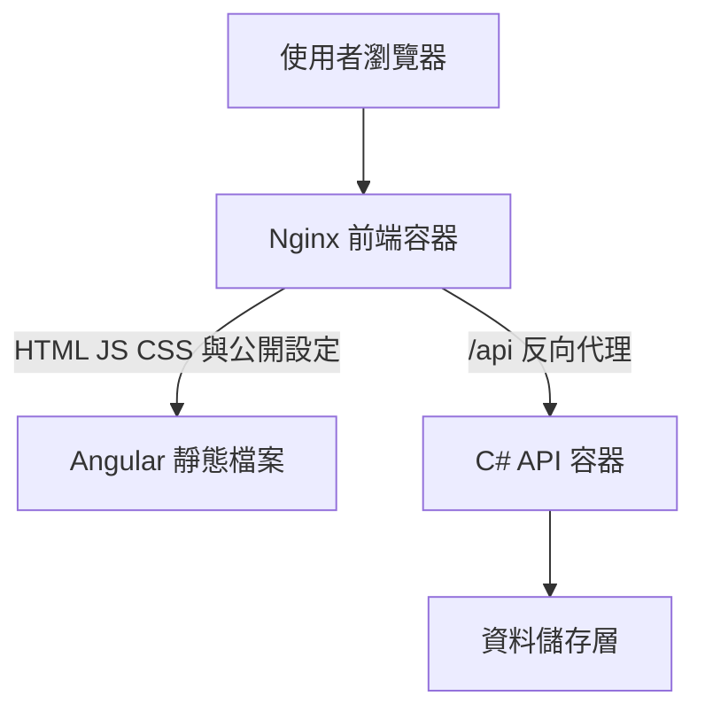
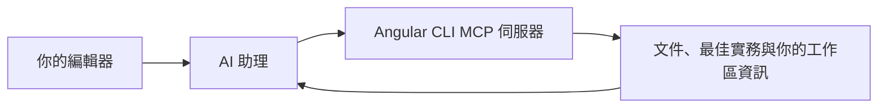

# 給 C# 工程師的 Angular 系統化學習教材（五）：容器部署、CLI 升級與未來趨勢（第 18～20 章）

> 🏠 [回總目錄 (README)](./README.md) ｜ ⬅️ [上一篇：04_測試除錯與共用元件架構_Ch14-17](./04_測試除錯與共用元件架構_Ch14-17.md) ｜ ➡️ [下一篇：06_附錄與速查總表_AppendixA-G](./06_附錄與速查總表_AppendixA-G.md)

## 本篇目錄

- [18. Docker、Nginx 與環境設定](#18-dockernginx-與環境設定)
- [19. CLI、Angular 22 升級與 AI 輔助維護](#19-cliangular-22-升級與-ai-輔助維護)
- [20. 八週實作安排與後續能力](#20-八週實作安排與後續能力)

---

## 18. Docker、Nginx 與環境設定

### 18.1 先確定交付的是哪種應用程式

本章延續純瀏覽器 SPA。Node.js 在建置階段編譯 TypeScript 與範本，正式階段由 Nginx 提供 HTML、CSS、JavaScript。C# API 由另一個容器執行。這是多階段建置適合處理的情境。[O26]



圖中的資料儲存層在練習 API 中是記憶體；正式系統通常改為資料庫。瀏覽器只需連前端網域，Nginx 將 API 路徑轉送到後端。

### 18.2 前端 Dockerfile

在 `product-admin/Dockerfile` 建立：

```dockerfile
ARG NODE_IMAGE=node:24-alpine
ARG NGINX_IMAGE=nginx:stable-alpine

FROM ${NODE_IMAGE} AS build
WORKDIR /app
COPY package.json package-lock.json ./
RUN npm ci
COPY . .
RUN npm run build -- --configuration production

FROM ${NGINX_IMAGE} AS runtime
COPY nginx.conf /etc/nginx/conf.d/default.conf
COPY --from=build /app/dist/product-admin/browser /usr/share/nginx/html
EXPOSE 80
CMD ["nginx", "-g", "daemon off;"]
```

`dist/product-admin/browser` 必須與實際輸出一致。先查看建置產物，不根據記憶猜路徑。範例 tag 用於練習；正式管線固定經過驗證的版本或 digest，並定期更新。Node 映像檔也必須符合該 Angular 版本的 patch 最低要求。

### 18.3 Nginx 路由與快取

在 `product-admin/nginx.conf` 建立：[O27]

```nginx
server {
    listen 80;
    server_name _;
    root /usr/share/nginx/html;
    index index.html;

    location /api/ {
        proxy_pass http://api:8080;
        proxy_set_header Host $host;
        proxy_set_header X-Forwarded-For $proxy_add_x_forwarded_for;
        proxy_set_header X-Forwarded-Proto $scheme;
    }

    location = /app-config.json {
        add_header Cache-Control "no-store" always;
        try_files $uri =404;
    }

    location = /index.html {
        add_header Cache-Control "no-cache" always;
    }

    location ~* \.(js|css|map|ico|png|jpg|jpeg|svg|woff|woff2)$ {
        try_files $uri =404;
        add_header Cache-Control "public, max-age=3600";
    }

    location / {
        try_files $uri $uri/ /index.html;
    }
}
```

`proxy_pass http://api:8080` 沒有結尾斜線，本例會保留 `/api/...` 路徑送到後端。若改成結尾帶斜線的形式，路徑替換行為可能不同，必須依 API 的路由設計驗證。

API 與設定檔有獨立 location，失敗不能回退為 index.html。否則 API 可能收到 200 與 HTML，前端卻期待 JSON。靜態檔案不存在時也回傳 404，方便辨識舊版 chunk 遺失。

這裡採保守的一小時資源快取。正式系統可對確定以內容雜湊命名的檔案使用更長快取，入口 HTML 與公開設定則需要不同策略；舊版本仍在開啟時，也要考慮其延遲 chunk 是否仍能取得。

### 18.4 dockerignore

在 `product-admin/.dockerignore` 建立：

```text
node_modules
dist
.angular
.git
coverage
npm-debug.log
.env
.env.*
```

### 18.5 後端練習映像檔

在 `ProductApi/Dockerfile` 建立：

```dockerfile
FROM mcr.microsoft.com/dotnet/sdk:10.0 AS build
WORKDIR /src
COPY . .
RUN dotnet publish ProductApi.csproj -c Release -o /out

FROM mcr.microsoft.com/dotnet/aspnet:10.0 AS runtime
WORKDIR /app
COPY --from=build /out .
ENV ASPNETCORE_URLS=http://+:8080
EXPOSE 8080
ENTRYPOINT ["dotnet", "ProductApi.dll"]
```

在 `ProductApi/.dockerignore` 排除 `bin`、`obj`、`.git` 與本機機密設定。此處的 .NET 映像 tag 同樣需要在正式環境固定及維護。

### 18.6 同一份前端映像檔，不同公開設定

在兩個專案的上層建立 `environments/local/app-config.json`：

```json
{
  "apiBaseUrl": "/api",
  "environmentName": "local-container"
}
```

上層 `compose.yaml`：

```yaml
services:
  web:
    build:
      context: ./product-admin
    image: product-admin:learning
    ports:
      - "8080:80"
    volumes:
      - ./environments/local/app-config.json:/usr/share/nginx/html/app-config.json:ro
    depends_on:
      - api

  api:
    build:
      context: ./ProductApi
    image: product-api:learning
    environment:
      ASPNETCORE_URLS: http://+:8080
```

```bash
docker compose up --build -d
docker compose logs web api
docker compose ps
```

開啟 [http://localhost:8080](http://localhost:8080)。測試完成可用 `docker compose down` 停止及移除此練習的容器。`depends_on` 的簡單形式只控制啟動順序，不保證 API 已可接受請求；自動化驗證應等待健康檢查或進行有限次重試。

容器內的 localhost 指自己。Nginx 使用 Compose 網路中的服務名稱 `api`；瀏覽器則使用 `/api` 同源路徑，不能將 `http://api:8080` 當成一般使用者可解析的網址。

### 18.7 編譯階段與執行階段設定

| 方法 | 生效時機 | 特性 |
|---|---|---|
| environment 檔案替換、建置 define | 編譯時 | 修改通常需要重新建置 |
| 掛載 app-config.json | 部署／執行時 | 可沿用同一映像檔，第 9 章先載入設定 |
| 容器 ENV | 容器啟動時 | 不會自動改已編譯的瀏覽器 JS |
| 同源反向代理 | 網站／閘道設定時 | 前端維持 `/api`，由環境決定後端 |

本例用檔案掛載避免直接拼接 JSON。若改成啟動腳本產生 JSON，應以能正確跳脫的 JSON 工具處理，而不是單純文字替換。所有傳給瀏覽器的設定仍是公開資訊。

### 18.8 CI/CD 的交付檢查

先執行鎖定安裝、測試與正式建置，再產生有明確版本的映像檔，掃描後推送到映像檔登錄庫。若 Dockerfile 也會建置，不要在管線不必要地重複編譯；可以選擇「容器內建置」或「先建置產物，再封裝」並保持來源一致。

部署後至少驗證入口頁、深層路由重新整理、設定檔、API 查詢與一次寫入流程。正式系統再加入 HTTPS、健康檢查、監控、回復版本及受信任反向代理設定。

前後端分開部署時，要驗證 API 契約相容性。前端切回舊映像檔，不會自動回復 API 或資料庫 schema；採向後相容的欄位新增與漸進移轉，才能降低獨立發布的風險。

**練習與完成條件：**在 8080 完成 CRUD；直接重新整理編輯路由仍能載入；`/api/not-exist` 不能回成 Angular HTML；修改掛載設定並重載網頁後可辨識環境，前端不需重新編譯。

### 18.9 原文完整整理：《使用 Docker 部署 Angular 應用程式：正式環境實務指南》

> 整合原文 5《使用 Docker 部署 Angular 應用程式：正式環境實務指南》。原文以「單一前端容器」為範圍；本教材 18.1～18.8 節則多了 API 反向代理與掛載公開設定，兩者可對照閱讀。

#### 18.9.1 為什麼要為 Angular 應用程式使用 Docker？

Angular 應用程式通常會編譯成靜態的 HTML、CSS 與 JavaScript 檔案。這些檔案在正式環境中**不需要**透過 Angular 開發伺服器執行，而是可以由 Nginx 等網頁伺服器提供服務。Docker 會把正式環境所需的檔案與網頁伺服器設定封裝成可重複使用的映像檔（image）。

重要優點：

- **環境一致**：同一個映像檔可以在不同環境執行。
- **簡化部署**：發布流程更容易重複執行。
- **縮小正式環境映像檔**：透過多階段建置，避免把 Node.js、npm 套件及建置工具放進最終映像檔。
- **容易整合**：搭配 CI/CD 系統及容器協調管理平台。
- **加快版本回復**：新版本出問題時，重新部署先前版本的映像檔。

> 💡 **C# 工程師這樣想**：如果你容器化過 ASP.NET Core，這章幾乎是同一套流程──多階段 Dockerfile（`sdk` 映像檔建置 → `aspnet` 映像檔執行）。差別是 Angular 最後階段**不需要任何執行環境**，只要一個靜態檔案伺服器（Nginx ≈ 一個只提供靜態檔的 IIS）。

#### 18.9.2 事前準備

- Node.js 與 npm
- Angular CLI
- Docker Desktop 或 Docker Engine
- 既有的 Angular 應用程式

需要範例專案時：

```bash
npm install -g @angular/cli
ng new angular-docker-demo
cd angular-docker-demo
ng serve
```

開啟 <http://localhost:4200> 確認可正常執行。

#### 18.9.3 建置正式環境版本

```bash
ng build --configuration production
```

Angular 會把編譯完成的應用程式寫入輸出目錄，通常在 `dist/` 底下。實際結構依 Angular 版本與建置設定而異；某些專案中，瀏覽器用的檔案放在 `browser` 子目錄，例如 `dist/angular-docker-demo/browser`。

> ⚠️ **設定 Nginx 之前，請先檢查產生的檔案。** 部署後出現 404 的常見原因之一，就是網頁伺服器指向了錯誤的目錄。

#### 18.9.4 建立 Dockerfile（多階段建置）

第一階段用 Node.js 編譯；第二階段只把正式環境需要的檔案複製到 Nginx 映像檔。在專案根目錄建立 `Dockerfile`：

```dockerfile
# Stage 1: Build the Angular application
FROM node:22-alpine AS build

WORKDIR /app

COPY package*.json ./
RUN npm ci

COPY . .
RUN npm run build -- --configuration production

# Stage 2: Serve files with Nginx
FROM nginx:alpine

COPY nginx.conf /etc/nginx/conf.d/default.conf

COPY --from=build /app/dist/angular-docker-demo/browser \
    /usr/share/nginx/html

EXPOSE 80

CMD ["nginx", "-g", "daemon off;"]
```

請將 `angular-docker-demo` 換成實際專案的輸出目錄名稱。若建置後的靜態檔直接放在 `dist/angular-docker-demo`，請移除路徑結尾的 `/browser`。正式環境應依組織的資安與維護政策，選擇並固定適當的基礎映像檔版本（注意 Angular 22.0.x 要求 Node.js `^22.22.3 || ^24.15.0 || ^26.0.0`，也可如第 18.2 節改用 `node:24-alpine`）。

**為什麼要多階段？** 第一階段包含 Node.js 與編譯所需的相依套件；第二階段只包含 Nginx 與產生的靜態資源。這避免把開發用相依套件放進最終映像檔，建立更精簡的正式執行環境。

> 💡 **C# 工程師這樣想**：
> - `npm ci` ≈ `dotnet restore`（依 lock 檔精準還原）。
> - `npm run build` ≈ `dotnet publish -c Release`。
> - `COPY --from=build` 和 ASP.NET Core 範本 Dockerfile 裡的 `COPY --from=publish /app/publish .` 一模一樣。
> - 先 `COPY package*.json` 再 `npm ci`、最後才 `COPY . .`，和先複製 `.csproj` 做 restore 是同一個「善用層快取」技巧。

#### 18.9.5 設定 Nginx 以支援 Angular 路由

Angular 常用用戶端路由（client-side routing）。從首頁導覽到 `/dashboard`、`/profile` 可能一切正常，但**重新整理頁面後卻出現 404**──因為 Nginx 會嘗試把每個路由當成實體檔案來找。

在專案根目錄建立 `nginx.conf`：

```nginx
server {
    listen 80;
    server_name _;
    root /usr/share/nginx/html;
    index index.html;

    location / {
        try_files $uri $uri/ /index.html;
    }

    location /assets/ {
        try_files $uri =404;
        expires 7d;
        add_header Cache-Control "public";
    }

    location = /index.html {
        add_header Cache-Control "no-cache";
    }
}
```

找不到對應檔案時，`try_files` 會把請求交由 `index.html` 處理，接著 Angular 在瀏覽器中接手導覽。上述快取政策僅為範例，請檢視應用程式的快取規則，確保經常更新的檔案能正確使快取失效。

> 💡 **C# 工程師這樣想**：`try_files $uri $uri/ /index.html` 就是 IIS URL Rewrite 的「SPA fallback」規則，或 ASP.NET Core 的 `app.MapFallbackToFile("index.html")`。回顧第 8.6 節的 SPA 原理。

#### 18.9.6 新增 `.dockerignore`

```text
node_modules
.git
.angular
dist
coverage
.env
.env.*
npm-debug.log
```

這避免不必要的檔案進入 Docker 建置內容（build context），也提升建置效能。若專案編譯時需要特定環境設定檔，確認需求後再調整排除規則。**切勿將機密資訊放入 Docker 映像檔或建置內容中。**

#### 18.9.7 建立並執行映像檔

```bash
docker build -t angular-docker-demo:1.0 .

docker run -d \
  --name angular-app \
  -p 8080:80 \
  angular-docker-demo:1.0
```

開啟 <http://localhost:8080>。`-p 8080:80` 把本機的 8080 連接埠對應到容器內的 80。

```bash
docker ps                   # 查看容器狀態
docker logs angular-app     # 查看伺服器記錄
docker stop angular-app     # 停止
docker rm angular-app       # 移除
```

若應用程式無法載入，先檢查建置輸出路徑、Nginx 設定及容器記錄。

#### 18.9.8 正確處理環境設定

Angular 環境設定檔通常在**編譯階段**使用。這表示**任何下載前端檔案的人，都能看到程式碼套件裡的設定值**。API 網址等公開設定可以放進去，但密碼、私密 API 金鑰與資料庫憑證**絕對不能**嵌入應用程式。

若希望在多個環境部署同一個映像檔，可在容器啟動時產生執行階段設定檔（例如 `assets/config.json`），再透過網頁伺服器提供。這樣維運團隊可修改公開設定而不必重新建置。請驗證設定檔格式，確保其中沒有機密。

> 💡 **C# 工程師這樣想**：這是 .NET 開發者最容易踩的坑。`appsettings.json` 放連線字串沒問題，因為它留在伺服器；但 Angular 的 `environment.ts` 會被打包進 JavaScript 送到每個使用者的瀏覽器，**等同公開**。任何需要祕密的操作都應該放在你的 ASP.NET Core 後端。

> 📌 **校正（依本教材第 18.7 節）**：另一個 .NET 慣性是以為「設 Docker 環境變數就會改到 Angular 設定」──`ASPNETCORE_ENVIRONMENT` 那套在前端**不成立**。已編譯的 JavaScript 不會自動讀取容器的 ENV，必須建立明確的設定載入流程。四種方式的比較：
>
> | 方法 | 生效時機 | 特性 |
> |---|---|---|
> | `environment` 檔案替換、建置 define | 編譯時 | 修改通常需要重新建置 |
> | 掛載 `app-config.json`（volume） | 部署／執行時 | 可沿用同一映像檔，應用程式啟動時先載入設定 |
> | 容器 ENV | 容器啟動時 | **不會自動改已編譯的瀏覽器 JS** |
> | 同源反向代理 | 網站／閘道設定時 | 前端維持 `/api`，由環境決定後端 |
>
> 本教材第 18.6 節以 `compose.yaml` 示範「同一份前端映像檔、掛載不同 `app-config.json`」，並同時啟動 ASP.NET Core API 容器，由 Nginx 以服務名稱 `api` 反向代理，瀏覽器只看到同源的 `/api`。若改成啟動腳本產生 JSON，要用能正確跳脫的 JSON 工具，不要用純文字替換。

> 📌 **補充（依本教材第 18.8 節）**：部署後至少驗證入口頁、深層路由重新整理、設定檔、API 查詢與一次寫入流程；`/api/not-exist` 不能被 `try_files` 回成 Angular 的 HTML（代理規則要排在 SPA fallback 之前）。前後端分開部署時，前端切回舊映像檔不會自動回復 API 或資料庫 schema，採向後相容的欄位新增與漸進移轉才能降低獨立發布的風險。

#### 18.9.9 整合至 CI/CD

典型管線：

1. 依據鎖定檔（lockfile）安裝相依套件。
2. 執行程式碼靜態檢查（linting）與自動化測試。
3. 建置 Angular 應用程式。
4. 建立 Docker 映像檔。
5. 掃描相依套件與映像檔中的資安漏洞。
6. 將帶有版本標籤的映像檔推送至容器映像檔登錄庫（container registry）。
7. 將經過核准的映像檔部署至目標環境。

請依發布版本或提交識別碼使用有意義的映像檔標籤，避免只依賴 `latest`。正式系統也應考慮健康狀態檢查、資源限制、HTTPS 終結處理（HTTPS termination）、存取記錄及版本回復策略。

#### 18.9.10 應避免的常見錯誤

- **輸出目錄錯誤**：確認建置結果是否使用 `browser` 子目錄。
- **缺少路由後備處理**：設定 Nginx 支援用戶端路由。
- **映像檔過大**：使用多階段建置與精簡映像檔。
- **前端程式碼包含機密資訊**：將所有傳送至瀏覽器的內容視為公開。
- **相依套件過時**：定期更新並掃描基礎映像檔與 npm 套件。
- **快取設定錯誤**：新版本需要立即生效時，避免為 `index.html` 設定長時間快取。
- **缺少部署驗證**：測試部署後的應用程式、API 連線及重要操作流程。

#### 18.9.11 結語

結合最佳化的正式環境建置、多階段 Dockerfile，以及針對用戶端路由設計的 Nginx 設定，就能建立輕量化容器。Docker 也為自動化測試、映像檔掃描、CI/CD 與容器協調管理建立基礎。從本機 Docker 部署開始，確認路由與正式環境設定，再逐步整合至團隊的發布管線。

---

## 19. CLI、Angular 22 升級與 AI 輔助維護

### 19.1 十個 CLI 操作放回使用情境

以下指令在 Angular 專案根目錄使用本機 CLI。遷移 schematic 的可用名稱與選項依安裝版本確認，必要時先加 `--help`。[O28]

| 目的 | 指令 | 使用前先理解 |
|---|---|---|
| 預覽產生檔案 | `npx ng g c name --dry-run` | 目標路徑與命名 |
| 遷移控制流程 | `npx ng g @angular/core:control-flow` | 原本的條件與 track 行為 |
| 遷移 Signal input | `npx ng g @angular/core:signal-input-migration --insert-todos` | 輸入是否被寫入、生命週期與繼承 |
| 遷移 inject | `npx ng g @angular/core:inject` | 注入情境與類別繼承 |
| 遷移延遲路由 | `npx ng g @angular/core:route-lazy-loading` | 可轉換的 standalone 路由及靜態引用 |
| 清理範本 imports | `npx ng g @angular/core:cleanup-unused-imports` | 不是刪除所有 npm 未使用套件 |
| 分析建置輸出 | `npx ng build --stats-json` | builder 與分析格式 |
| 查看可更新套件 | `npx ng update` | 查詢結果不是已完成升級 |
| 檢查／清除建置快取 | `npx ng cache info`、`npx ng cache clean` | 先保留實際錯誤證據 |
| 啟動 CLI MCP | `npx ng mcp` | 由支援 MCP 的 AI 用戶端連線 |

遷移工具通常無法保證所有自訂包裝、動態用法、外部函式庫都可自動轉換。不要把「讓每個路由延遲載入」解讀成工具可以處理任意架構，或延遲載入必然適合每個首頁區塊。

### 19.2 遷移作業流程

```bash
git status
git switch -c migrate/signal-inputs
npx ng g @angular/core:signal-input-migration --insert-todos
git diff
npx ng build --configuration production
npx ng test --watch=false
```

先確認工作目錄狀態，再建立分支。一次做一項遷移，檢查差異、測試與操作驗收通過後提交。工具留下的 TODO 是待判斷內容，不能只為讓搜尋結果消失而刪掉。

### 19.3 Angular 22 變更核對

| 變更 | 學習重點 | 升級時應驗證 |
|---|---|---|
| 預設 OnPush、Eager 名稱 | 第 6 章的通知機制 | 計時器、外部回呼與原地修改 |
| Signal Forms 穩定 | 第 12 章的模型來源 | 現有控制項及第三方表單相容性 |
| resource/httpResource 穩定 | 查詢狀態與相依重跑 | 空資料、錯誤、競態與寫入後刷新 |
| 預設 Fetch | HTTP 後端實作改變 | 檔案上傳進度、SSR 與特殊選項 |
| `@Service()` | 自動提供服務的簡化 API | DI 提供範圍與原有註冊方式 |
| `injectAsync()` | 按需載入服務 | loader 的匯出型態及實際 chunk |
| strictTemplates | 範本也接受嚴格型別檢查 | DTO、null/undefined 與事件型別 |
| 範本 `?.` 回傳 undefined | 與 JavaScript 語意對齊 | 以 `=== null` 判斷的既有範本 |
| 路由參數預設繼承 always | 父子路由參數合併 | 同名參數與巢狀導覽 |

`@Service()` 可以簡化常見服務宣告：

```typescript
import { Service } from '@angular/core';

@Service()
export class CatalogState {}
```

這不代表應把所有服務文字取代後就合併。原本有額外 provider、factory 或不同注入範圍時，仍需檢查語意。[O10]

### 19.4 上傳進度與 Fetch

若瀏覽器 SPA 確實需要 XHR 的上傳進度，可評估：

```typescript
import { provideHttpClient, withXhr } from '@angular/common/http';
// 在適當的 providers 中使用：
provideHttpClient(withXhr());
```

不要未經驗證就把整個 SSR 應用改成 XHR。官方 withXhr 文件明確區分瀏覽器上傳需求與伺服器端限制。實際上傳呼叫的進度選項也依目標版本 API 檢查。[O33]

### 19.5 不要用 !value 修復所有空值判斷

Angular 22 對範本 `?.` 的語意調整需要檢查。[O31]

```html
<!-- 明確表示 manager 不存在，接受 null 與 undefined -->
@if (user?.manager == null) {
  <p>未指定主管</p>
}
```

`== null` 在這個特定用途會同時涵蓋 null/undefined。若團隊規則要求嚴格比較，就明列兩種情況。`!value` 還涵蓋 `false`、`0`、空字串，只有當這些也符合業務語意時才能使用。

檢查 `ng update` 產生的 `$safeNavigationMigration()` 等相容處理，先確認原本的 null 語意，再逐一修改。路由若需保留舊參數繼承方式，可明確設定：[O32]

```typescript
import { provideRouter, withRouterConfig } from '@angular/router';
provideRouter(routes, withRouterConfig({ paramsInheritanceStrategy: 'emptyOnly' }));
```

這是獨立設定片段；主線沒有依賴舊的父子參數繼承，所以不需要照貼。

### 19.6 升級主要版本

```bash
npx ng update @angular/core@22 @angular/cli@22
```

這適用於已具備適當前置版本的升級步驟，不能把 Angular 13 或 19 直接視為可以跳過所有中間主要版本。依官方 Update Guide 逐一主要版本升級；每一階段同時核對 Node、TypeScript、測試框架及第三方 peer dependencies。[O30]

### 19.7 AI 與 MCP

可讓支援 MCP 的工具在專案目錄啟動本機 CLI：[O29]

```json
{
  "mcpServers": {
    "angular-cli": {
      "command": "npx",
      "args": ["--no-install", "ng", "mcp"]
    }
  }
}
```

用戶端的工作目錄必須指向已安裝 Angular CLI 的專案；不同工具設定工作目錄的欄位不一定相同，依該工具文件處理。這裡用 `--no-install` 避免默默下載另一個版本。CLI 提供的 MCP 工具清單依版本與設定為準，不把文章列出的工具名稱當成永久 API。

交付 AI 任務時，明確提供目前 Angular/TypeScript 版本、檔案邊界、API 契約、採用的表單方式與驗收條件。例如：

> 在既有 Angular 22.2 專案新增庫存篩選。保留現有 Reactive Forms 編輯頁。查詢條件透過 API 的 minStock 參數傳遞，前後端都驗證整數與範圍。呈現載入、空資料與失敗狀態，補上 HTTP 查詢參數測試。先檢查目前專案的檔名與 imports，再修改。

審查 AI 產出時，至少能自行解釋資料流、相依版本、錯誤路徑與測試的保護範圍。AI 完成編譯不等於功能、授權、可存取性與效能都已驗證。

**練習與完成條件：**在分支只做一次可追蹤的遷移並檢查差異；能指出工具無法判斷的業務語意；為 AI 產出設計至少一個會使錯誤實作失敗的驗收情境。

### 19.8 原文完整整理：Angular 22 的七項變更、不相容變更與升級判斷

> 整合原文 1《Angular 22 有哪些新功能？現在該升級嗎？》與原文 6《Angular 22 的 7 項變更：打破你的習慣，而不是你的應用程式》的完整內容。變更 2、3、6 的完整範例與校正已分別收錄於 12.4、10.5、15.5 節，此處保留摘要與連結以便按順序對照。

#### 19.8.1 Angular 22 的定位

Angular 22 於 2026 年 6 月推出。原文 1 的評價是：它的特色不在某個吸睛的新功能，而是 **Angular 多年來推動的響應式（reactive）架構藍圖，終於不再停留在實驗階段**。如果你的企業團隊一直因為 API 仍是實驗性而暫緩升級，Angular 22 就是新的基準。

原文 6 作者的親身經歷則點出另一面：升級本身很順利──四分鐘通過所有測試，主控台沒有紅字，建置沒有失敗。問題在星期一早上：一位同事用 2019 年以來的寫法建了新元件，**畫面不動了**。沒有錯誤、沒有警告，底層資料持續變動，畫面上的計數器卻停在零。他花了兩小時以為是自己的程式有問題。

> **Angular 22 不會弄壞你的應用程式。** 遷移用的 schematics 太完善了。它打破的是你的習慣──那些手指比大腦先打出來的寫法。

一張簡圖掌握整體轉變（原文 6）：


##### 升級前先確認環境

Angular 22 需要 **TypeScript 6** 和 **Node 22 或更新版本**，不再支援 TypeScript 5.9 和 Node 20。請先檢查 CI 映像檔──原文 6 作者沒檢查，白白耗掉二十分鐘。

> 💡 **C# 工程師這樣想**：等同於 .NET 主版本升級時 `global.json` 與 CI 的 SDK 映像檔也要跟著換。

#### 19.8.2 七項變更逐一說明

每一項都依原文 6 的結構：**問題 → 變更 → 結果**，並補上 C# 類比。

##### 變更 1：OnPush 成為預設值（舊策略更名為 Eager）

**問題**：多年來每個新元件都用舊的預設策略。只要應用程式任何地方發生點擊、計時器觸發或 HTTP 回應，Angular 就檢查元件樹中的**每一個**元件。寬容，但慢。

**變更**：新元件預設採用 `ChangeDetectionStrategy.OnPush`。舊的 `Default` 策略正式更名為 `ChangeDetectionStrategy.Eager`。執行 `ng update` 時，遷移程序會自動替**既有**元件明確加上 `Eager`，維持原本行為，避免升級後突然失效。只有你**新建立**的元件才遵循新規則。

讓原文作者團隊踩坑的程式碼：

```typescript
@Component({
  selector: 'app-counter',
  template: `<p>{{ count }}</p>`
})
export class Counter {
  count = 0;

  constructor() {
    setInterval(() => this.count++, 1000);
  }
}
```

在 OnPush 下，透過計時器修改一般欄位，不會通知 Angular。數值變了，畫面不更新。修正關鍵只有一個字：`signal`。

```typescript
export class Counter {
  count = signal(0);

  constructor() {
    setInterval(() => this.count.update(c => c + 1), 1000);
  }
}
```

範本改成 `{{ count() }}`。Signal 會明確告訴 Angular 哪個元件需要更新。


**結果**（示範情境：40 個元件、500 列資料表格的儀表板，在搜尋欄位輸入文字）：

| 指標 | Eager | OnPush + signals |
|---|---:|---:|
| 每次按鍵輸入檢查的元件數 | 40 | 3 |
| 每次按鍵輸入的指令碼執行時間 | 約 11 ms | 約 2 ms |

> ⚠️ 原文 6 的提醒：**不要在一次大型提交中刪掉遷移程序加入的所有 `Eager`。** 逐一處理元件，而且只有在該元件已經改用 signals 讀取狀態後，才移除它的 `Eager`。

> 💡 **C# 工程師這樣想**：這就像把 WPF 的 `UpdateSourceTrigger` 從「永遠重算」改成「只在 `PropertyChanged` 時更新」。用普通欄位 `count++` 等於沒發 `PropertyChanged`，畫面當然不動。回顧第 6.4 節。

##### 變更 2：Signal Forms 正式穩定

- **問題**：Reactive Forms 需要 `FormGroup`、`FormControl`、`valueChanges` 訂閱及 `ControlValueAccessor`，學習與維護門檻較高。
- **變更**：Signal Forms（`@angular/forms/signals`）正式穩定。資料放在 `signal()`，以 `form(model, schema)` 宣告驗證規則，並用 `[formField]` 繫結欄位。
- **結果**：型別直接由資料模型推導，免除手動管理 `valueChanges` 訂閱與 `ControlValueAccessor`。
- **完整程式碼、C# 類比與官方校正**：請見 **[第 12.4 節（原文對照：Signal Forms 正式穩定）](./03_前後端API串接與表單實作_Ch09-13.md#124-原文對照signal-forms-正式穩定)**（注意：Reactive Forms 並未棄用，兩套表單可依情境選用，但不可混綁於同一欄位）。

##### 變更 3：`httpResource()` 正式穩定，告別載入狀態旗標

- **問題**：手寫 `http.get().subscribe()` 常需要同時維護 `data`、`loading`、`error` 三個欄位，且路由參數快速切換時容易發生過期回應覆蓋新資料的競態條件（race condition）。
- **變更**：`resource()`、`rxResource()` 與 `httpResource()` 正式穩定，當相依的 Signal 改變時會自動重新請求並丟棄過期回應。
- **結果**：大幅減少狀態樣板程式碼並自動處理查詢競態（查詢用 `httpResource`，寫入仍維持明確呼叫後 `reload()`）。
- **完整程式碼、流程圖與 C# 類比**：請見 **[第 10.5 節（原文對照：`httpResource()` 正式穩定）](./03_前後端API串接與表單實作_Ch09-13.md#105-原文對照httpresource-正式穩定告別載入狀態旗標)**。

##### 變更 4：HttpClient 預設使用 Fetch

**問題**：Angular 的 `HttpClient` 原本建立在 `XMLHttpRequest` 之上。雖然可以透過 `withFetch()` 啟用 Fetch，但大多數人從來沒開過。

**變更**：Fetch 現在是預設值，`withFetch()` 標示為棄用（deprecated）。

```typescript
// Angular 21
provideHttpClient(withFetch())

// Angular 22
provideHttpClient()
```

舊的 `reportProgress` 選項也已棄用，拆成兩個：

```typescript
this.http.post('/api/files', data, {
  reportUploadProgress: true,
  observe: 'events'
});
```

**結果**：既有的攔截器（interceptors）仍然可以運作。伺服器端渲染與瀏覽器使用相同的請求處理流程，設定中少了一個 provider。

> ⚠️ 如果應用程式有附帶進度列的檔案上傳功能，請在發布前**手動測試**。若出現異常，一行 `provideHttpClient(withXhr())` 就能恢復舊的後端實作。遷移程序也會在它判斷有需要的地方自動加入。

> 💡 **C# 工程師這樣想**：像 .NET 把 `HttpWebRequest` 換成 `HttpClient` 當預設實作──API 介面不變，底層換了。攔截器 ≈ `DelegatingHandler`。

##### 變更 5：`@Service()` 取代 `@Injectable` 的樣板寫法

**問題**：九成的服務都長這樣，憑記憶打過幾百次：

```typescript
@Injectable({ providedIn: 'root' })
export class CartService {}
```

**變更**：

```typescript
@Service()
export class CartService {}
```

**結果**：一樣是單例（singleton），但少了冗餘的程式碼，而且任何人看到 `@Service()` 都能直接理解用途。`@Injectable` 仍可使用，不必急著修改。原文 1 補充：`@Service` 搭配 `injectAsync()`，讓大型服務模組能實現真正的非同步相依性注入與程式碼分割。

##### 變更 6：`injectAsync()` 讓大型服務延遲載入

- **問題**：封裝 PDF、圖表或大型編輯器的服務若透過同步注入，即使多數使用者不點擊，整套相依也會被打進主要套件（main bundle）。
- **變更**：`injectAsync(() => import('./pdf.service').then(m => m.PdfService))` 透過動態匯入，在使用者真正觸發功能時才下載並實例化服務。
- **結果**：有效縮減初始套件體積，將大型服務推遲至需要時載入。
- **完整程式碼、校正注意事項與 C# 類比**：請見 **[第 15.3 節](./04_測試除錯與共用元件架構_Ch14-17.md#153-injectasync-的完整命名匯出寫法)** 與 **[第 15.5 節（原文對照：`injectAsync()` 讓大型服務延遲載入）](./04_測試除錯與共用元件架構_Ch14-17.md#155-原文對照injectasync-讓大型服務延遲載入)**。

##### 變更 7：`strictTemplates` 預設啟用，`?.` 改為回傳 `undefined`

**問題**：寬鬆的範本檢查讓許多錯誤也能通過編譯。多年來範本中的 `?.` 會回傳 `null`，同樣的程式碼在 TypeScript 中卻回傳 `undefined`。

**變更**：`strictTemplates` 預設啟用；若專案原本沒用，遷移程序會加入 `strictTemplates: false`。範本中的可選串連運算子（optional chaining）現在遵循 TypeScript 行為，回傳 `undefined`。

這個微小差異可能藏著實際錯誤：

```html
@if (user?.manager === null) {
  <p>No manager assigned</p>
}
```

Angular 21：`user` 不存在時會顯示訊息。Angular 22：`user?.manager` 是 `undefined`，條件不成立，訊息悄悄消失。正確寫法：

```html
@if (!user?.manager) {
  <p>No manager assigned</p>
}
```

**結果**：遷移程序會用 `$safeNavigationMigration()` 包住可能受影響的運算式，維持原本行為。升級後請在專案中搜尋這個名稱──**每一個搜尋結果都代表範本有一處依賴舊行為**。逐一修正，等條件允許再移除 `strictTemplates: false`。

> 📌 **校正（依本教材第 19.5 節）**：**不要用 `!value` 修復所有空值判斷。** `!user?.manager` 除了 `null` / `undefined` 之外，也會把 `false`、`0`、空字串當成「沒有」，只有在這些值也符合業務語意時才能用。若意思是「manager 不存在」，更精準的寫法是寬鬆相等 `== null`（同時涵蓋 `null` 與 `undefined`）：
>
> ```html
> @if (user?.manager == null) {
>   <p>No manager assigned</p>
> }
> ```
>
> 若團隊規則要求嚴格比較，就明列 `=== null || === undefined` 兩種情況。（這是第 2.9 節「永遠用 `===`」的唯一合理例外。）

> 💡 **C# 工程師這樣想**：`strictTemplates` ≈ 把範本也納入 `<Nullable>enable</Nullable>` + `TreatWarningsAsErrors`。`?.` 的差異則回顧第 2.3 節：JavaScript 有兩種「沒有值」。

#### 19.8.3 唯一沒有自動遷移的變更：路由參數繼承

路由器的 `paramsInheritanceStrategy` 預設值改為 `'always'`，代表深層巢狀的子路由會自動繼承父路由的參數，而且**沒有自動遷移程序**。如果子路由會讀取參數且程式依賴舊行為，請在路由器設定中明確指定 `'emptyOnly'`，或仔細測試巢狀路由。

要保留舊行為的具體寫法（`app.config.ts`，補自本教材第 19.5 節）：

```typescript
import { provideRouter, withRouterConfig } from '@angular/router';

provideRouter(routes, withRouterConfig({ paramsInheritanceStrategy: 'emptyOnly' }));
```

特別要檢查的是**父子路由有同名參數**的情況（例如父層 `:id` 是客戶、子層 `:id` 是訂單），`'always'` 會讓子層拿到合併後的參數。

#### 19.8.4 不相容變更總整理（原文 1）

| 項目 | 內容 |
|---|---|
| TypeScript | 必須升級至 TypeScript 6 |
| Node.js | 不再支援 Node 20，需 Node 22 以上 |
| 路由參數繼承 | `paramsInheritanceStrategy` 預設 `'always'`；需要獨立參數時改 `'emptyOnly'` |

#### 19.8.5 其他預設行為變更（原文 1）

- **增量式水合（Incremental Hydration）預設啟用**：`provideClientHydration()` 現在預設自動啟用增量式水合，搭配 `@defer` 延後載入耗資源的元件，不必再反覆設定功能旗標。
- **移除 Zone.js 與舊 Webpack／XHR 的額外負擔**：套件體積更小。

> 📌 **校正（依本教材第 15.4 節）**：「預設啟用增量式水合」的前提是你**已經採用伺服器端渲染（SSR）與 hydration 設定**。純 SPA（例如第 18 章用 Nginx 提供靜態檔的後台）不會因為升級就自動多出 SSR，也不會有水合行為。若要改為 SSR，還需處理伺服器環境沒有 `window` / `document`、每位使用者的資料隔離、可轉移快取的範圍，以及部署一個 Node 執行環境──第 18 章的純靜態 Nginx 映像檔不能直接執行 SSR 伺服器。同樣地，「升級一定自動變快」也不成立：升級不會消除 API 太慢、大量 DOM、無效查詢與不必要的運算。

#### 19.8.6 現在該升級嗎？

原文 1 的結論：**是，應該立即升級。** 繼續停留在舊版本意味著持續背負已棄用功能的技術債（例如 `FormGroup` 與 `Default` 變更偵測策略），而整個生態系正快速轉向新做法。升級後可獲得：

1. **開箱即用的效能改善**：預設 OnPush 與增量式水合。
2. **更小的套件體積**：移除 Zone.js 與舊有 Webpack／XHR 的負擔。
3. **為未來做好準備**：即將推出的編譯器改善、TypeScript 7（TSGo）的效能提升，以及範本型別檢查能力。

#### 19.8.7 升級檢查清單（原文 6）

1. 將 CI 與本機環境升級至 Node 22 和 TypeScript 6。
2. 執行 `ng update @angular/core@22 @angular/cli@22`。
3. 搜尋 `Eager`、`withXhr`、`strictTemplates: false` 和 `$safeNavigationMigration`。每一個結果都是遷移程序留給你的提醒。
4. 手動測試附帶進度列的檔案上傳功能。
5. 測試會讀取父路由參數的巢狀路由。
6. 下一個元件使用 signals，下一份表單使用 Signal Forms，下一次資料擷取使用 `httpResource()`。

#### 19.8.8 真正的升級，發生在你的思維裡

執行 `ng update` 可能只需要一個下午；改掉習慣可能需要一整季。原文 6 的觀點：清單中的每項變更都移除了過去必須手動撰寫的內容──載入狀態旗標、訂閱、樣板裝飾器、過期回應造成的錯誤。**Angular 不是要求你學更多，而是希望你少寫一點。** 所以給自己一點時間，也對那位星期一早上計數器突然不動的同事多一點耐心。

### 19.9 原文完整整理：《10 個能省下數小時的 Angular CLI 指令》

> 整合原文 7《10 個能省下數小時的 Angular CLI 指令（多數開發者從沒用過）》的完整內容；第 19.1 節的表格是精簡版。

#### 19.9.1 為什麼要讀這章

只要一個 Angular 指令，就能把專案裡所有的 `*ngIf` 改寫成新的控制流程語法，執行時間比讀完這段還短。但多數團隊仍選擇手動修改──一次改一個檔案、一次送一個 Pull Request，耗上好幾週。我們每週用 CLI 上百次，對 `ng serve`、`ng build`、`ng generate component` 熟到不能再熟，卻幾乎從不看它還能做什麼。

> 💡 **C# 工程師這樣想**：這些指令就是 Angular 版的 **Roslyn Analyzer + Code Fix**（「套用到整個方案」那顆按鈕），或是 .NET Upgrade Assistant。差別是它們直接從 CLI 執行，而且 Angular 團隊維護、經過數千個專案測試。

#### 19.9.2 執行任何指令之前：先建立安全防護

以下有幾個指令會改寫程式碼。把它們當成電動工具使用，每次執行時遵循：

1. 執行 `git status`，確認工作目錄乾淨。
2. 執行 `git switch -c migrate/control-flow`，建立遷移用的分支。
3. 執行**一項**遷移。
4. 執行 `ng build && ng test`。
5. 檢查差異，再提交變更。
6. 執行下一項遷移，並另外建立一筆提交。

> 經驗提醒：不要連續執行三項遷移、最後才一次提交。問題發生時，你會希望能明確知道是哪個工具造成的。

#### 19.9.3 十個指令

##### 1. `--dry-run`：預覽任何產生器的執行結果

**問題**：在錯誤的資料夾執行 `ng generate`，結果得手動刪檔案、修匯入。

```bash
ng generate component user-card --dry-run
```

CLI 會列出它**預計建立或更新**的所有檔案，但不寫入磁碟。確認路徑正確後移除旗標再執行一次。簡寫 `-d`。只要是在巢狀資料夾產生檔案，就養成先預覽的習慣。

##### 2. 遷移到新的控制流程語法

**問題**：範本裡到處是 `*ngIf`、`*ngFor`、`[ngSwitch]`。你知道 `@if`、`@for` 是未來方向，但沒人想把整個 Sprint 花在手動轉換數百個範本上。

```bash
ng generate @angular/core:control-flow
```

```html
<!-- Before -->
<li *ngFor="let user of users; trackBy: byId">
  {{ user.name }}
</li>

<!-- After -->
@for (user of users; track byId($index, user)) {
  <li>{{ user.name }}</li>
}
```

專案很大時用 `--path` 一次遷移一個資料夾。完成後再回頭簡化 `track` 運算式：`track user.id` 比呼叫舊函式更容易閱讀。

##### 3. 將 `@Input()` 轉換成 Signal 輸入

**問題**：用裝飾器宣告的輸入屬性無法搭配 `computed()`，因此只是為了回應數值變化，就得寫 `ngOnChanges` 或 setter。

```bash
ng generate @angular/core:signal-input-migration --insert-todos
```

```typescript
// Before
@Input() name = '';
@Input({ required: true }) id!: string;

// After
name = input('');
id = input.required<string>();
```

遷移工具也會更新所有讀取輸入屬性的位置，自動補上 `()`。對於無法安全遷移的輸入，`--insert-todos` 會留下註解說明原因──待辦清單就這樣自動產生了。

另外兩個相關指令採用相同模式：`@angular/core:output-migration` 和 `@angular/core:signal-queries-migration`。

##### 4. 將建構函式注入改成 `inject()`

**問題**：建構函式光是為了接收服務就塞了六個參數，又長又難讀。

```bash
ng generate @angular/core:inject
```

```typescript
// Before
constructor(
  private http: HttpClient,
  private router: Router
) {}

// After
private http = inject(HttpClient);
private router = inject(Router);
```

這種寫法更適合搭配繼承，以及路由守衛（Guard）、攔截器（Interceptor）等函式型 API。新的 Angular 範例也都採用這種方式。

##### 5. 讓每個路由都採用延遲載入

**問題**：每個頁面元件都在路由檔案頂端直接匯入，全部被打包進主要套件。使用者只是想看登入頁，卻連管理後台的程式碼都得下載。

```bash
ng generate @angular/core:route-lazy-loading
```

```typescript
// Before
{ path: 'reports', component: Reports }

// After
{
  path: 'reports',
  loadComponent: () => import('./reports/reports').then(m => m.Reports)
}
```


執行這個指令前後都跑一次第 7 個指令，主要套件縮減了多少，就是你可以寫進 Pull Request 說明的數字。

##### 6. 移除整個專案中未使用的匯入項目

**問題**：獨立元件的 `imports` 清單像塞滿雜物的抽屜：`CommonModule`、`NgIf`，還有早就沒人在用的 Pipe。Angular 一次只提醒一項。

```bash
ng generate @angular/core:cleanup-unused-imports
```

所有元件 `imports` 陣列中未使用的項目會一次移除。建議在完成控制流程遷移後立刻執行，因為那經常留下已經沒人用的 `NgIf` 和 `NgFor`。

##### 7. 看清楚打包檔裡到底有什麼

**問題**：建置時警告打包檔大小超過預算限制，但完全不知道是哪個函式庫造成的。

```bash
ng build --stats-json
```

這會在輸出資料夾產生 `stats.json`。把它放進 [esbuild 套件分析工具](https://esbuild.github.io/analyze/)，就能看到視覺化分布圖。


在多數專案中，不到一分鐘就會發現一兩個出乎意料的項目。

##### 8. 找出哪些套件需要更新

```bash
ng update
```

不帶參數執行**不會變更任何內容**。它會列出有更新版本的套件，並顯示更新各套件應執行的完整指令。每週一規劃升級工作前可以先做這件事。準備好更新時，一次只升級一個主要版本，並依照 [Angular 更新指南](https://angular.dev/update-guide)操作。

##### 9. 透過清除快取，修復莫名其妙的建置錯誤

**問題**：建置失敗、錯誤訊息毫無道理、你什麼都沒改，同一個分支在同事電腦上卻能建置。

```bash
ng cache info
ng cache clean
```

CLI 保留持久化的建置快取以加快重建。通常在切換分支或升級套件後，快取會過時。**刪除 `node_modules` 之前先試這個，快得多。**

> 💡 **C# 工程師這樣想**：相當於清 `obj/` 與 `bin/` 之前先試 `dotnet nuget locals all --clear`──同樣是「快取污染」這類問題。

##### 10. 讓 AI 助理取得真正的 Angular 知識

**問題**：AI 程式開發助理寫出來的 Angular 程式碼還停留在 2021 年：`NgModule`、`*ngIf`、建構函式注入。它不了解你的專案，也不知道目前的最佳實務。

```bash
npx @angular/cli mcp
```

這會啟動 Angular CLI MCP 伺服器，可加入任何支援模型情境協定（Model Context Protocol，MCP）的編輯器或助理：

```json
{
  "mcpServers": {
    "angular-cli": {
      "command": "npx",
      "args": ["-y", "@angular/cli", "mcp"]
    }
  }
}
```

助理會取得 Angular 團隊打造的工具：

- `get_best_practices`：官方 Angular 最佳實務指南。
- `search_documentation`：搜尋 angular.dev 文件，不必憑空猜測。
- `list_projects`：列出工作區中的應用程式與函式庫。
- `onpush_zoneless_migration`：分析程式碼並規劃遷移至 OnPush。



差異會立刻顯現：要求它建立元件時，會使用 Signal、獨立元件與新的控制流程語法，因為助理正在讀 Angular 團隊寫的同一份指南。

> 📌 **補充（依本教材第 19.7 節）**：在已安裝 Angular CLI 的專案目錄中，建議改用本機版本並加上 `--no-install`，避免 `npx` 默默下載另一個版本的 CLI：
>
> ```json
> {
>   "mcpServers": {
>     "angular-cli": {
>       "command": "npx",
>       "args": ["--no-install", "ng", "mcp"]
>     }
>   }
> }
> ```
>
> AI 用戶端的工作目錄必須指向該專案。原文列出的 MCP 工具名稱（`get_best_practices` 等）依 CLI 版本與設定為準，不是永久 API。交付 AI 任務時，明確提供目前 Angular / TypeScript 版本、檔案邊界、API 契約、採用的表單方式與驗收條件；AI 完成編譯不等於功能、授權、可存取性與效能都已驗證。

> 📌 **補充（依本教材第 19.1 節）**：遷移 schematic 的可用名稱與選項依安裝版本而定，執行前可先加 `--help` 確認。遷移工具通常無法處理自訂包裝、動態用法與外部函式庫，不要把「讓每個路由延遲載入」解讀成工具能處理任意架構。工具留下的 TODO 是待判斷的內容，不能只為了讓搜尋結果消失而刪掉。

#### 19.9.4 指令速查表

| # | 指令 | 用途 |
|---|---|---|
| 1 | `ng generate ... --dry-run` | 預覽不寫入 |
| 2 | `ng generate @angular/core:control-flow` | `*ngIf` / `*ngFor` → `@if` / `@for` |
| 3 | `ng generate @angular/core:signal-input-migration --insert-todos` | `@Input()` → `input()` |
| 4 | `ng generate @angular/core:inject` | 建構函式注入 → `inject()` |
| 5 | `ng generate @angular/core:route-lazy-loading` | 路由改延遲載入 |
| 6 | `ng generate @angular/core:cleanup-unused-imports` | 清除未使用匯入 |
| 7 | `ng build --stats-json` | 打包分析 |
| 8 | `ng update` | 列出可升級套件 |
| 9 | `ng cache clean` | 清除建置快取 |
| 10 | `npx @angular/cli mcp` | 啟動 Angular MCP 伺服器 |

原文的速查表圖片：

建議的遷移順序（搭配第 19.8 節）：**2 → 6 → 3 → 4 → 5**，每一步各自提交。

> 原文的小挑戰：從清單中挑選**一個**指令，今天就在乾淨的分支上執行，然後看看差異。

---

## 20. 八週實作安排與後續能力

### 20.1 每週以能交付的成果前進

每週約 8～11 小時為起點。未通過完成條件時，延長該階段，不把日期當成必須跳過練習的理由。

| 週次 | 研讀範圍 | 實作成果 | 驗收重點 |
|---|---|---|---|
| 第 1 週 | 1～2 | 純 HTML 表單、TypeScript 產品資料處理 | 理解執行位置、型別與 JSON 邊界 |
| 第 2 週 | 3～5 | Angular 專案、靜態清單與事件 | 能建置，能處理四種畫面狀態 |
| 第 3 週 | 6～8 | 搜尋、元件拆分、路由 | Signal 更新正確，輸入與輸出清楚 |
| 第 4 週 | 9～10 | C# API、設定、代理、清單查詢 | URL 正確，錯誤與空資料可辨識 |
| 第 5 週 | 11～13 | 新增、編輯、刪除及 Signal Forms 對照 | API 與前端都驗證，失敗保留輸入 |
| 第 6 週 | 14～15 | 八個基礎測試、效能紀錄 | 能從測試與 Network 解釋正確性 |
| 第 7 週 | 16～17 | Angular 套件、純 HTML 承載自訂元素 | 公開契約、版本與執行環境成本明確 |
| 第 8 週 | 18～19 | 容器部署、深層路由、一次 CLI 遷移 | 能重現建置、驗證部署並追蹤變更 |

### 20.2 學完後的獨立延伸題

把產品後台增加「分頁、排序、最低庫存、上架狀態篩選」，並將條件放到 URL。由 API 執行分頁與篩選，回傳資料及總筆數，不要先下載全部資料再假裝完成伺服器分頁。

驗收至少包含：條件重新整理後仍存在；快速切換條件不顯示過期結果；刪除最後一頁最後一筆後，頁碼能回到有效範圍；非法 query parameter 會套用明確規則；API 失敗不顯示成零筆成功結果。

這項練習同時驗證 TypeScript、元件、Signals、路由、非同步、API 契約與錯誤處理，比再抄一個計數器更能呈現是否掌握資料流。

### 20.3 將 2026～2031 趨勢轉換成現在可練的能力

| 文章中的方向 | 現在可做的練習 | 不應直接推論 |
|---|---|---|
| Signals 與 zoneless | 明確管理狀態、量測更新路徑 | 所有 RxJS 都應刪除 |
| AI 輔助開發 | 提供契約、審查差異、設計失敗情境 | 能編譯就代表需求正確 |
| 渲染與載入效能 | 比較 lazy route、defer、SSR 的適用情境 | 每個後台都需要 SSR |
| 清楚的架構邊界 | 依功能組織檔案，明確資料所有權 | 一開始就需要微前端或大量套件 |
| 測試與無障礙 | 邊界測試、鍵盤操作與錯誤呈現 | 只看覆蓋率或掃描分數即可 |
| 共用與交付能力 | 公開 API、版本、容器、監控 | Web Components 會自動解決部署整合 |

這是依文章方向整理的學習安排，不是 Angular 官方對 2031 年的版本承諾。新的功能是否適用，以官方狀態、團隊維護能力與實際量測決定。

### 20.4 能力自我檢核

完成教材後，應能在沒有 AI 代答的情況下解釋並實作以下事項：

- 描述程式在瀏覽器、建置機與 API 伺服器各自做什麼。
- 把 API JSON 定義成 TypeScript 型別，並指出執行時驗證在哪裡進行。
- 選擇狀態的擁有者，使用 input/output 與 DI 建立清楚資料流。
- 分辨 Signal、computed、Promise、Observable 各適合處理的問題。
- 正確處理查詢競態、路由參數變更、資源清理及重複提交。
- 完成表單驗證，保留失敗輸入，理解前端檢查不能取代 API 驗證。
- 從 Network、Console 與伺服器記錄定位問題。
- 解釋函式庫、Web Component 與一般元件的共用範圍。
- 建置並部署 SPA，理解路由 fallback、API 代理與公開設定。
- 閱讀升級差異，判斷自動遷移與 AI 產出仍需人工驗證的部分。

### 20.5 原文完整整理：《Angular 開發的未來（2026–2031）：7 大趨勢》

> 整合原文 3《Angular 開發的未來（2026–2031）：每位開發者都該提前準備的 7 大趨勢》。第 20.3 節已把這些趨勢轉成現在可練的能力，這裡提供原文的完整論述與程式碼。

網頁開發從未停止演進。Angular 早已超越最初以模組、元件與相依性注入為核心的定位，現代 Angular 越來越重視獨立元件、Signals、改良的渲染策略、伺服器端渲染與開發者生產力。沒有人能預測每次更新，但目前的工程方向已提供值得參考的線索。

#### 20.5.1 Signals 可能成為應用程式架構的核心

Signals 提供以響應式方式表示數值與狀態的機制，值變化時依賴它的部分自動更新。

```typescript
import { Component, signal } from '@angular/core';

@Component({
  selector: 'app-counter',
  standalone: true,
  template: `
    <h2>Count: {{ count() }}</h2>
    <button (click)="increment()">Increase</button>
  `
})
export class CounterComponent {
  count = signal(0);

  increment() {
    this.count.update(value => value + 1);
  }
}
```

（原文範例的 `standalone: true` 與 `Component` 後綴在 Angular 22 已可省略；signal 的用法則與現在完全一致。精簡後：）

```typescript
import { Component, signal, computed } from '@angular/core';

@Component({
  selector: 'app-counter',
  template: `
    <h2>Count: {{ count() }}</h2>
    <p>Double: {{ double() }}</p>
    <button (click)="increment()">Increase</button>
  `
})
export class Counter {
  count = signal(0);
  double = computed(() => this.count() * 2);

  increment() {
    this.count.update(value => value + 1);
  }
}
```

開發者可以直接表達狀態變化，不必手動協調每個相依值的更新。未來幾年，Signals 可能越來越普遍成為元件狀態、衍生值與響應式 UI 邏輯的基礎。這不代表 RxJS 會消失：對非同步串流、事件處理、取消操作與複雜資料流程，RxJS 仍然很有價值，兩者會搭配使用。

**應該學習**：`signal()`、`computed()`、`effect()`，以及 Signals 如何與範本、服務和 RxJS 互動。（本教材第 6 章。）

#### 20.5.2 不依賴 Zone.js 的 Angular

過去 Angular 用 Zone.js 協助偵測可能需要更新 UI 的非同步操作，實用但有額外負擔，也讓複雜應用的變更偵測難以理解。無 Zone.js（zoneless）變更偵測讓框架依靠明確的通知與響應式機制更新畫面。可能的優點：更容易預期的渲染行為、較低的框架負擔、更容易的效能分析。

不過，**單純移除 Zone.js 並不保證應用程式變快**。元件設計不佳、不必要的處理、過大的套件、效率不佳的網路請求，仍會造成效能問題。

**應該學習**：變更偵測、`OnPush`、Signals 與渲染行為，並學會在最佳化之前先針對實際應用程式進行效能剖析。（第 6.4、19.8 節。）

#### 20.5.3 AI 將改變 Angular 開發者建構應用程式的方式

AI 工具可產生元件骨架、建議單元測試、說明不熟悉的程式碼庫、找出潛在錯誤，以及協助將舊寫法遷移到現代 API。例如要求 AI 產生一個支援排序、分頁、載入狀態與無障礙操作的可重複使用表格元件──可作為起點，但仍需仔細審查。

AI 產生的程式碼可能包含資安漏洞、錯誤假設、不必要的抽象或過時的 API。**不能只因為程式碼可以編譯，就直接接受它。** 真正的優勢來自懂得引導 AI、驗證產出並理解底層程式碼的開發者。AI 也會影響應用程式本身：Angular 前端可能越來越常串接 AI 搜尋、文件分析、推薦引擎與對話式介面。

**應該學習**：撰寫有效的提示詞、審查產生的程式碼、安全地整合 API、驗證回應內容、設計實用的 AI 使用者體驗。（第 19.9 節第 10 個指令的 MCP 伺服器就是讓 AI 寫出現代 Angular 程式碼的工具。）

#### 20.5.4 效能將不再只是 Lighthouse 分數

Angular 應用程式可能依實際需求更廣泛運用伺服器端渲染、靜態渲染、水合、延遲載入與可延後載入的檢視（deferrable views）。想像一個電子商務儀表板：商品搜尋、分析、客戶報表與管理設定。對只需要看商品清單的使用者，一開始就載入所有功能只是浪費資源。

```html
@defer (on viewport) {
  <app-analytics-dashboard />
} @placeholder {
  <p>Analytics will load when visible.</p>
}
```

當延後載入的元件耗費較多資源且策略適合該頁面時，就能減少初始處理工作。但仍需量測實際使用情境下的效能，不能假設每項最佳化都有效。

**應該學習**：套件分析（第 19.9 節第 7 個指令）、Core Web Vitals、延遲載入、SSR、水合、快取與效能剖析。

#### 20.5.5 Angular 架構將更重視清楚的邊界

隨著規模成長，架構的重要性超過團隊能產出多少元件。大型企業應用程式包含身分驗證、報表、付款、管理、客戶管理等功能；若缺乏清楚邊界，業務邏輯就會散落各處。一個實用的目錄結構：

```text
src/app/
  core/
    auth/
    interceptors/
  shared/
    components/
    pipes/
  features/
    dashboard/
    customers/
    reports/
  app.routes.ts
```

這只是其中一種可能。獨立元件與延遲載入路由可以協助組織功能，不必依賴大量 NgModules。狀態管理則依問題性質，使用 Signals、服務、RxJS、NgRx 或結合多種方式。

**應該學習**：以功能為導向的架構、相依性注入、可重複使用的元件、具型別定義的 API、狀態管理的取捨、容易維護的測試策略。

> 💡 **C# 工程師這樣想**：`core/` ≈ 跨切面關注點（認證、HTTP handler），`shared/` ≈ 共用 UI 類別庫，`features/` ≈ 依垂直功能切分的專案（Vertical Slice Architecture）。你在 .NET 的分層經驗完全可以帶過來。

#### 20.5.6 測試與無障礙設計將成為核心工程技能

現代應用程式不會因為在瀏覽器裡看起來正常就算完成。它必須處理非預期的 API 回應、保護使用者資料、支援鍵盤導覽、清楚傳達錯誤，並在不同裝置與輔助科技下正常使用。

單元測試驗證業務邏輯，元件測試確認行為，端對端測試涵蓋重要的使用者操作流程。AI 輔助測試可能有助於產生案例，但開發者仍必須判斷哪些情境重要。無障礙設計（語意化 HTML、符合要求的表單標籤、鍵盤操作、清楚的焦點指示、適當的動態內容通知）應納入日常開發。例如製作表單時，除了測試系統是否拒絕無效輸入，也應確認使用者能否理解錯誤，並透過鍵盤或螢幕閱讀器移動到問題欄位。

**應該學習**：Angular 測試工具、整合測試與端對端測試、無障礙基礎、安全程式設計、有實質作用的程式碼審查。

#### 20.5.7 Angular 開發者需要更廣泛的前端技能

熟悉 Angular 仍有價值，但單靠框架知識可能無法滿足資深職位的要求。瀏覽器渲染、JavaScript、TypeScript、HTTP、快取、安全性、無障礙、部署流程都能讓開發者受益。整合各自獨立的介面系統時，Web Components（第 17 章）、微前端架構與設計系統也可能變得重要。雲端平台、容器（第 18 章）、持續整合、監控與正式環境除錯的知識，有助於理解程式碼離開本機之後會發生什麼事。AI 素養也將成為實用技能。

目標不是學會每一種技術，而是對整體系統有足夠的理解，能夠做出合理的工程決策。

#### 20.5.8 實務學習路線圖：2026–2031

與其一次學會所有東西，不如分階段建立能力：

| 階段 | 重點 | 對應本教材 |
|---|---|---|
| **2026–2027** | Angular 基礎、獨立元件、Signals、RxJS、TypeScript、路由與響應式表單 | 第 1～12 章 |
| **2027–2028** | 效能、無 Zone.js 變更偵測、測試、無障礙設計、容易維護的架構 | 第 6、14～15 章 |
| **2028–2029** | AI API、安全整合、伺服器端渲染、現代部署流程 | 第 18、19 章 |
| **2029–2030** | 系統設計、可觀測性、應用程式安全、可擴充的前端架構 | 第 16～17 章 |
| **2030–2031** | 持續評估 Angular 新功能、瀏覽器標準、AI 輔助工作流程、新的效能技術 | ─ |

這些是學習里程碑，不是預測特定功能何時成為標準。隨著 Angular 演進與專案需求改變，應適時調整。

八週實作進度見第 20.1 節。

#### 20.5.9 結語：未來屬於持續學習的開發者

Angular 的未來不會只取決於某一項功能。但無論框架朝哪個方向發展，扎實的工程基礎始終有價值。相較於追逐每一項新趨勢，能理解自己寫的程式碼、量測效能、設計無障礙介面、撰寫有實質作用的測試並審慎做出架構決策的開發者，更能因應變化。

先從理解目前可用的工具開始。實際動手開發專案。以批判思考探索新功能。了解解決方案為什麼有效，而不只是複製它的實作。

> **Angular 開發的未來，不只是減少程式碼的撰寫量，更在於打造更好的軟體、做出更明智的決策，以及創造值得使用者信賴的使用體驗。**

---

> 🏠 [回總目錄 (README)](./README.md) ｜ ⬅️ [上一篇：04_測試除錯與共用元件架構_Ch14-17](./04_測試除錯與共用元件架構_Ch14-17.md) ｜ ➡️ [下一篇：06_附錄與速查總表_AppendixA-G](./06_附錄與速查總表_AppendixA-G.md)
---

<!-- 官方參考資料連結定義（供本篇內文 [O1]～[O36] 參照） -->
[O1]: https://angular.dev/reference/releases
[O2]: https://angular.dev/reference/versions
[O3]: https://www.typescriptlang.org/docs/handbook/typescript-in-5-minutes-oop.html
[O4]: https://angular.dev/guide/http/making-requests
[O5]: https://angular.dev/essentials/components
[O6]: https://angular.dev/guide/components/lifecycle
[O7]: https://angular.dev/guide/signals
[O8]: https://angular.dev/guide/components/advanced-configuration
[O9]: https://angular.dev/guide/zoneless
[O10]: https://angular.dev/api/core/Service
[O11]: https://angular.dev/guide/routing/define-routes
[O12]: https://learn.microsoft.com/en-us/aspnet/core/fundamentals/minimal-apis?view=aspnetcore-10.0
[O13]: https://angular.dev/guide/http/http-resource
[O14]: https://angular.dev/guide/signals/resource
[O15]: https://angular.dev/guide/forms/reactive-forms
[O16]: https://angular.dev/guide/forms/signals/comparison
[O17]: https://angular.dev/guide/forms/signals/form-submission
[O18]: https://angular.dev/guide/http/testing
[O19]: https://angular.dev/best-practices/security
[O20]: https://angular.dev/guide/templates/defer
[O21]: https://angular.dev/guide/di/lazy-loading-services
[O22]: https://angular.dev/tools/libraries/creating-libraries
[O23]: https://angular.dev/tools/libraries/angular-package-format
[O24]: https://angular.dev/guide/elements
[O25]: https://angular.dev/api/platform-browser/createApplication
[O26]: https://docs.docker.com/build/building/multi-stage/
[O27]: https://nginx.org/en/docs/http/ngx_http_core_module.html#try_files
[O28]: https://angular.dev/reference/migrations
[O29]: https://angular.dev/ai/mcp
[O30]: https://angular.dev/update-guide
[O31]: https://angular.dev/guide/templates/expression-syntax
[O32]: https://angular.dev/api/router/RouterConfigOptions
[O33]: https://angular.dev/api/common/http/withXhr
[O34]: https://angular.dev/api/platform-browser/provideClientHydration
[O35]: https://angular.dev/guide/ssr
[O36]: https://angular.dev/essentials/signal-forms
